# TSCTF-J 题解
前面忘了，后面忘了，总之，这是此生唯一的机会（~~不是~~）。
## Misc
### PlayIt
只连接了一次，不知道是不是随机题目。总之这道数独题非常简单，直接就能写出来。 

### FindIt
给了脚本和音频。脚本流程是先加载音频和bgm，然后随机选音频，在音频开头和末尾之外，随机选取起点截取五秒，然后添加干扰，最后把音频编码成base64发到客户端。  
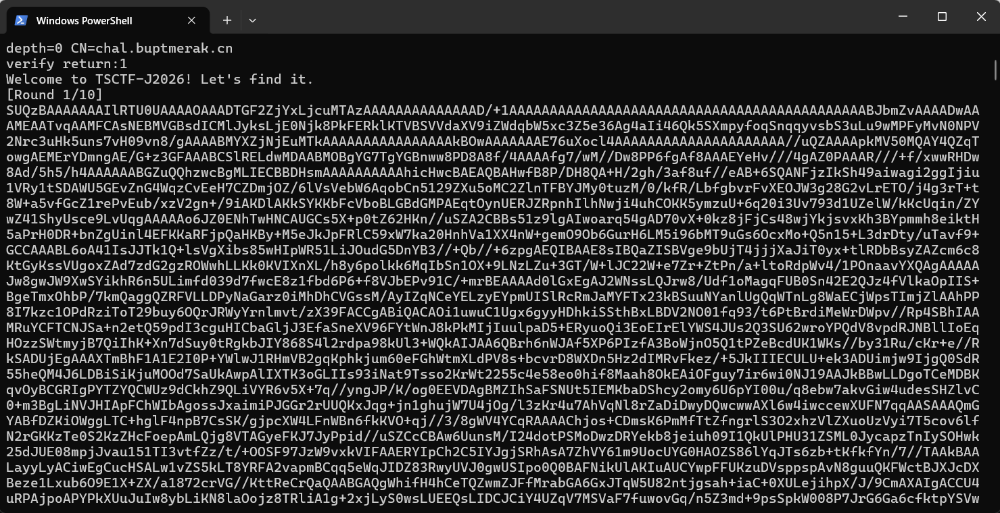  
这道题的要求是10道题至少对9个，总共只有3秒回答时间，回答格式是文件名加起点秒数。  
也就是说最终要处理的难点是对抗干扰、确定音频、确定起点。  
考虑到要确定起点秒数，我的想法是将所有音频去掉头尾后按秒拆成一个个特征点，然后根据特征点去对应题目。总共一百段音频，最长六分钟，最短两分钟，取平均值四分钟，掐掉30秒，总共20000秒左右，也就是说最终大概有20000个特征点。  
实际做了一版发现漏了一些东西，单纯1秒的一个特征点很容易匹配到相似音频而无法确定精准文件，所以在原来的方案上应该把特征点改成索引，每个索引对应了从这一秒开始往后的5秒的音频，最后把所有索引存到内存中，实际只占用了大约86MiB。  
最后需要考虑的是干扰项，`random_filter_complex`函数里包含了变调、bgm、白噪、回声、滤波。音频的波形、音量、频谱等都会受到明显影响，没有找到可以不用抗干扰的方案。求助AI后，由于题库总体规模不大，提前保存五秒的频谱特征比较容易实现 ，最终得到的方案是对数频谱特征（~~对数真好用啊~~）。  
流程是先统一音频为12kHz单声道减少数据量，然后每隔50ms计算一次短时频谱，舍弃一部分高低频，频率范围取180Hz~5400Hz，然后映射到128个对数频率位置，之后选择半秒聚合一次。由上可得，一个五秒片段等于10个时间块*128个频率位置，形成一个10×128的矩阵。然后提取局部频谱对比（衡量某个频率强度相对于附近频率有多突出），设原本幅度为M，取对数为lnM，如果音量乘以g，取对数等于lnM+lng，接着沿频率方向做高斯平滑，C=L-G(L)。此时发现，整体增益产生的常数lng同时出现在原对数频谱和平滑结果中，相减时会抵消。最后对其进行变调补偿，对数坐标中频率从f变调为pf相当于lnf+lnp，频率轴上整体平移，可以计算频率位置移动量等于lnp/lnr，其中r是相邻两个频率位置的倍率。服务端脚本里已经给出了变调的参数范围，但实际p未知，所以对题目特征尝试平移，试出一个合适的补偿量。最后用余弦相似度判断补偿后的特征与候选片段有多相似，每个五秒片段对应1280维向量，计算原曲候选向量和题目变体向量的余弦相似度，最后选择最高分答案。（需要声明的是这一部分的数学推导是由AI完成，这些东西对我来说还是太超标了）
```python
#FindIt 音频识别核心：离线建库、识别 MP3 / Base64，不包含网络连接。

from __future__ import annotations

import os

# 必须在导入 NumPy 前设置，避免小批量匹配启动过多计算线程。
os.environ.setdefault("OPENBLAS_NUM_THREADS", "4")
os.environ.setdefault("OMP_NUM_THREADS", "4")
os.environ.setdefault("MKL_NUM_THREADS", "4")

import argparse
import base64
import io
import json
from pathlib import Path
import sys
import time

import av
import numpy as np
from scipy import ndimage, signal
from scipy.fft import rfft

HERE = Path(__file__).resolve().parent
SR = 12000               # 统一为 12 kHz 单声道；最高表示频率为 6000 Hz。
FFT = 2048               # 分析窗口约 170.7 ms，FFT 频率格间距约 5.86 Hz。
HOP = 600                # 每隔 50 ms 提取一帧。
BINS = 128               # 每帧保留 128 个对数分布的频率位置。
POOL = 10                # 连续 10 帧取平均，得到一个 0.5 秒时间块。
SLICES = 10              # 10 个时间块对应题目的 5 秒。
VERSION = 1              # 与现有索引格式兼容。
FREQUENCIES = np.geomspace(180, 5400, BINS).astype(np.float32)
# 对数频率轴平移，11 个候选；覆盖原曲 44100 Hz 时题目的 ±5% 变调。
PITCH_SHIFTS = np.arange(-2.5, 2.51, 0.5, dtype=np.float32)


def decode_audio(source):
    """将文件路径或 MP3 字节解码为单声道采样数组，另返回原采样率。"""
    if isinstance(source, bytes):
        source = io.BytesIO(source)
    elif isinstance(source, Path):
        source = str(source)
    parts = []
    with av.open(source) as container:
        stream = container.streams.audio[0]
        native_rate = stream.codec_context.sample_rate
        resampler = av.AudioResampler(format="fltp", layout="mono", rate=SR)
        for frame in container.decode(stream):
            for result in resampler.resample(frame):
                parts.append(result.to_ndarray().reshape(-1))
        # 排空重采样器缓冲区，保留末尾尚未返回的样本。
        for result in resampler.resample(None):
            parts.append(result.to_ndarray().reshape(-1))
    if not parts:
        raise ValueError("音频没有可解码的采样数据")
    return np.concatenate(parts), native_rate


def extract_features(samples):
    """每 0.5 秒生成一个 128 维特征向量，五秒得到形状 (10, 128)。"""
    # 以 25、75、125……ms 为分析中心；首尾补零供窗口读取。
    centres = np.arange(HOP // 2, len(samples), HOP)
    padded = np.pad(samples, (FFT // 2, FFT // 2))
    frames = np.lib.stride_tricks.sliding_window_view(padded, FFT)[centres]
    window = signal.windows.hann(FFT, sym=False).astype(np.float32)
    mag = np.abs(rfft(frames * window, axis=1)).astype(np.float32)

    # 对幅度谱轻微平滑，然后线性插值到指定的对数频率位置。
    mag = ndimage.gaussian_filter1d(mag, 0.8, axis=1)
    positions = FREQUENCIES * FFT / SR
    lower = positions.astype(int)
    fraction = positions - lower
    log_frequency_mag = mag[:, lower] * (1 - fraction) + mag[:, lower + 1] * fraction

    # 每十帧取平均；保留时间块之间的先后顺序。
    length = len(log_frequency_mag) // POOL * POOL
    pooled = log_frequency_mag[:length].reshape(-1, POOL, BINS).mean(axis=1)

    # 取对数并减去宽频谱包络，突出局部结构，减轻音量和滤波影响。
    features = np.log(np.maximum(pooled, 1e-5))
    features -= ndimage.gaussian_filter1d(features, 3.0, axis=1)
    # 限制极端特征的权重；此步骤不会自动分离 BGM 或消除噪声。
    return np.clip(features, -2.0, 2.0).astype(np.float32)


def normalize(rows):
    """沿最后一维归一化，使点积等于余弦相似度；下限用于防止除零。"""
    return rows / np.maximum(np.linalg.norm(rows, axis=-1, keepdims=True), 1e-8)


def build_index(tracks_dir, index_dir):
    """离线建立五秒窗口索引；已有匹配索引时无需重复执行。"""
    tracks = sorted(Path(tracks_dir).glob("*.mp3"))
    if not tracks:
        raise ValueError(f"目录中没有 MP3：{tracks_dir}")
    if len({path.stem for path in tracks}) != len(tracks):
        raise ValueError("曲库文件名去掉扩展名后必须唯一")
    output = Path(index_dir)
    output.mkdir(parents=True, exist_ok=True)
    matrices, ids, starts, catalog = [], [], [], []
    for number, path in enumerate(tracks):
        samples, rate = decode_audio(path)
        # 服务端写死 asetrate=44100*pitch，本实现按 44100 Hz 原曲建库。
        if rate != 44100:
            raise ValueError(f"{path.name} 的采样率为 {rate} Hz，本索引要求原曲为 44100 Hz")
        duration = len(samples) / SR
        features = extract_features(samples)
        # 起点从第 15 秒开始，每隔一秒建立一个连续五秒的候选。
        # 尾部多保留少量候选，兼容 MP3 容器时长与解码时长的差异。
        seconds = np.arange(15, int(duration) - 8, dtype=np.int32)
        seconds = seconds[seconds * 2 + SLICES <= len(features)]
        if not len(seconds):
            raise ValueError(f"音频太短，没有可索引的五秒窗口：{path}")
        # 特征间隔为半秒，所以整数秒起点乘以 2 对应特征行号。
        windows = features[seconds[:, None] * 2 + np.arange(SLICES)]
        matrices.append(normalize(windows.reshape(len(seconds), -1)))
        ids.extend([number] * len(seconds))
        starts.extend(seconds.tolist())
        catalog.append({"id": path.stem, "file": str(path.resolve()), "duration": duration,
                        "sample_rate": rate, "size": path.stat().st_size})
        print(f"[{number + 1}/{len(tracks)}] {path.name}: {len(seconds)} 个候选", flush=True)
    np.save(output / "features.npy", np.concatenate(matrices).astype(np.float32))
    np.save(output / "track_ids.npy", np.asarray(ids, dtype=np.int32))
    np.save(output / "starts.npy", np.asarray(starts, dtype=np.int32))
    metadata = {"version": VERSION, "tracks": catalog, "sr": SR, "fft": FFT,
                "hop": HOP, "bins": BINS, "pool": POOL}
    (output / "metadata.json").write_text(json.dumps(metadata, indent=2), encoding="utf-8")
    print(f"索引已保存：{output.resolve()}，共 {len(ids)} 个候选", flush=True)


class Matcher:
    def __init__(self, index_dir=HERE / "index"):
        """一次性把索引加载到内存，多道题复用同一个 Matcher。"""
        directory = Path(index_dir)
        self.metadata = json.loads((directory / "metadata.json").read_text(encoding="utf-8"))
        expected = {"version": VERSION, "sr": SR, "fft": FFT,
                    "hop": HOP, "bins": BINS, "pool": POOL}
        if any(self.metadata.get(key) != value for key, value in expected.items()):
            raise ValueError("索引参数不匹配，请使用本脚本重新建库")
        self.matrix = np.load(directory / "features.npy", allow_pickle=False)
        self.ids = np.load(directory / "track_ids.npy", allow_pickle=False)
        self.starts = np.load(directory / "starts.npy", allow_pickle=False)
        self.tracks = self.metadata["tracks"]
        count = len(self.matrix)
        if (not count or self.matrix.shape != (count, SLICES * BINS)
                or self.ids.shape != (count,) or self.starts.shape != (count,)):
            raise ValueError("索引为空或各数组的形状不一致")
        # 提前触发矩阵运算初始化，不放到首次识别的计时中。
        self.matrix @ np.zeros((SLICES * BINS, len(PITCH_SHIFTS)), np.float32)

    def match(self, mp3, top=5):
        """识别 MP3 字节或路径，返回最佳答案、候选列表和识别耗时。"""
        if top < 1:
            raise ValueError("top 必须大于等于 1")
        t0 = time.perf_counter()
        samples, _ = decode_audio(mp3)
        features = extract_features(samples)
        if len(features) < SLICES:
            raise ValueError(f"需要五秒题目，当前仅解码出 {len(samples) / SR:.3f} 秒")
        features = features[:SLICES]

        # 在对数频率轴上平移，相当于搜索频率倍率补偿；不平移时间轴。
        queries = []
        for shift in PITCH_SHIFTS:
            shifted = ndimage.shift(features, (0, float(shift)), order=1,
                                    mode="nearest", prefilter=False)
            queries.append(shifted.reshape(-1))
        queries = normalize(np.asarray(queries, dtype=np.float32))

        # 一次矩阵乘法比较全部候选与全部补偿量。
        # matrix: 候选数 × 1280；queries.T: 1280 × 11。
        scores = self.matrix @ queries.T
        best_shifts = scores.argmax(axis=1)
        best_scores = scores[np.arange(len(scores)), best_shifts]
        count = min(top, len(best_scores))
        indices = np.argpartition(best_scores, -count)[-count:]
        indices = indices[np.argsort(best_scores[indices])[::-1]]
        candidates = []
        for idx in indices:
            track = self.tracks[int(self.ids[idx])]["id"]
            start = int(self.starts[idx])
            candidates.append({"answer": f"{track}_{start}", "score": float(best_scores[idx]),
                               "shift": float(PITCH_SHIFTS[best_shifts[idx]])})
        # score 是相似度，不是正确概率；shift 的单位是对数频率格。
        return {"answer": candidates[0]["answer"], "candidates": candidates,
                "elapsed_ms": (time.perf_counter() - t0) * 1000}

    def match_base64(self, payload, top=5):
        """接收单条题目的 Base64 字符串/字节；允许文本中的空白和换行。"""
        if isinstance(payload, str):
            payload = payload.encode("ascii")
        mp3 = base64.b64decode(b"".join(payload.split()), validate=True)
        return self.match(mp3, top=top)


def main():
    for stream in (sys.stdout, sys.stderr):
        if hasattr(stream, "reconfigure"):
            stream.reconfigure(encoding="utf-8")
    parser = argparse.ArgumentParser(description=__doc__, formatter_class=argparse.RawDescriptionHelpFormatter)
    sub = parser.add_subparsers(dest="command", required=True)
    build = sub.add_parser("build", help="从原始曲库离线建立索引")
    build.add_argument("--tracks", default=str(HERE / "tracks"))
    build.add_argument("--index", default=str(HERE / "index"))
    match = sub.add_parser("match", help="识别本地 MP3 或纯 Base64 文本文件")
    match.add_argument("input", type=Path)
    match.add_argument("--base64", action="store_true", help="输入文件包含纯 Base64 音频载荷")
    match.add_argument("--index", default=str(HERE / "index"))
    match.add_argument("--top", type=int, default=5)
    args = parser.parse_args()
    try:
        if args.command == "build":
            build_index(args.tracks, args.index)
        else:
            if args.top < 1:
                parser.error("--top 必须大于等于 1")
            matcher = Matcher(args.index)
            payload = args.input.read_bytes()
            result = matcher.match_base64(payload, args.top) if args.base64 else matcher.match(payload, args.top)
            print(json.dumps(result, ensure_ascii=False, indent=2))
        return 0
    except (OSError, ValueError, av.error.FFmpegError) as error:
        print(f"Error: {error}", file=sys.stderr)
        return 1


if __name__ == "__main__":
    raise SystemExit(main())

```
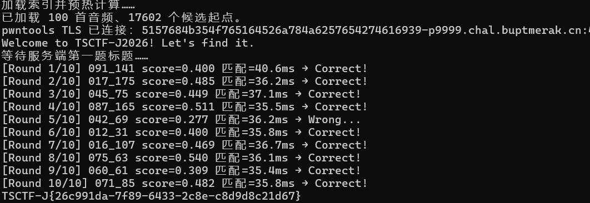
~~AI写脚本还是太权威了~~
### フラグの恋
（打完之后才知道，原来是不用全撕开的，悲）  
一开始搞不明白字符串的含义，后面求助AI发现竟然是兽音，怎么还和宣讲的例子挂上钩了。  
兽音用鸡你太美解出密码和网盘地址（这里就看出来不对劲了，为什么密码和galgame有关，联想到宣讲会的galgame高手，这题应该考察了一堆解压相关的知识点），网盘里是一个加密文件，查看文件头可知是SSEFE，用SSEFE解密后得到一个lz4文件（~~不是说没有什么找工具的题目吗~~）。  
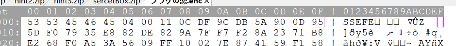
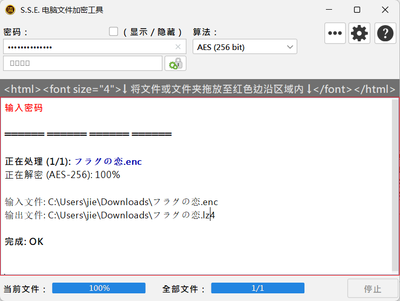  
查询可知lz4是一种使用LZ4算法压缩生成的高速压缩文件，wsl下载了lz4相关工具之后解压得到一个zip压缩包，文件最后还有一串密码（露出鸡脚这块）。  
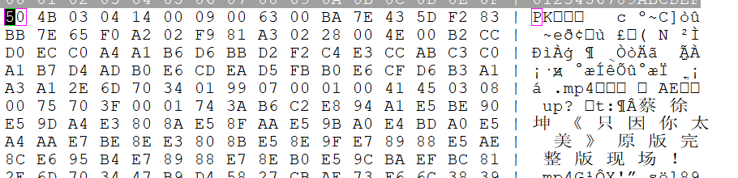  
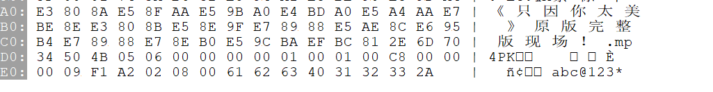
视频中的哥哥没有任何问题，但是转身运球的那一帧能看出篮球背面有东西，截图可得二维码。  
  
解码结果为`pwd is 114514`，算是提示了视频后面还藏了文件。找了一下视频后面果然有504B0304，EOCD后注释长度为D7，215个字节，把这部分提取出来之后可以得到zip压缩包，解压后得到了……galgame?  
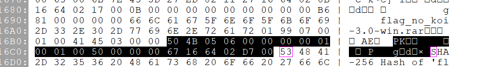  
~~来都来了，玩一下吧~~  
~~游戏不会改编自真实故事吧~~  
需要咒语，从文件里找一下吧
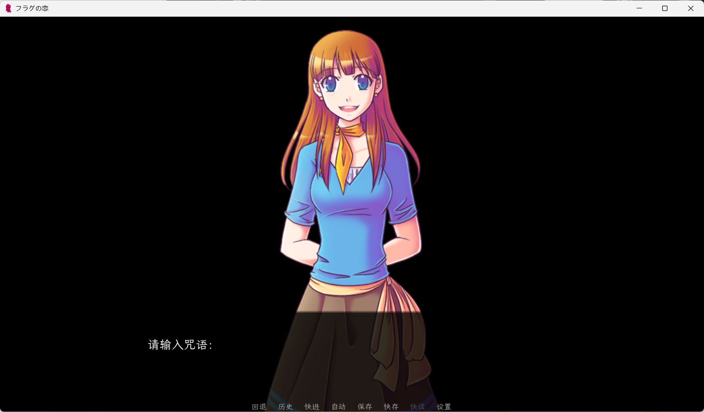    
先解包`archive.rpa`，文件头被改了，没办法用常规解包工具提取内容，AI检查后发现在`loader.py`文件中保留了了解包逻辑，用AI写个解包脚本。  
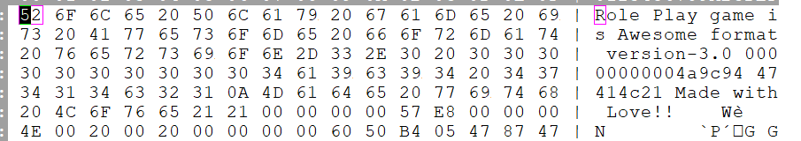  
```python
from pathlib import Path
import pickle,io,zlib,json
ROOT=Path(__file__).resolve().parent
class DataOnlyUnpickler(pickle.Unpickler):
    def find_class(self,module,name):
        raise ValueError(f'Non-data pickle global {module}.{name}')
data=(ROOT/'game/archive.rpa').read_bytes()
header=data.split(b'\n',1)[0]
offset,key=[int(x,16) for x in header.rsplit(b' ',2)[1:]]
print('header',header,'index',offset,'key',hex(key))
index=DataOnlyUnpickler(io.BytesIO(zlib.decompress(data[offset:]))).load()
out=ROOT/'rpa_extract'; out.mkdir(exist_ok=True)
for name, chunks in index.items():
    target=(out/name).resolve()
    assert target.is_relative_to(out.resolve())
    blob=b''
    for chunk in chunks:
        off,length=chunk[:2]; off^=key; length^=key
        prefix=chunk[2] if len(chunk)==3 else b''
        if isinstance(prefix,str): prefix=prefix.encode('latin1')
        blob+=prefix+data[off:off+length-len(prefix)]
    target.parent.mkdir(parents=True,exist_ok=True)
    target.write_bytes(blob)
    if not name.startswith(('images/','gui/','audio/')): print(name,len(blob),repr(blob[:40]))
(ROOT/'rpa_filelist.json').write_text(json.dumps(list(index),ensure_ascii=False,indent=2),encoding='utf-8')

```
解包后去找剧情脚本，试试能不能直接读取到输入正确咒语之后的文本。  
```python
from pathlib import Path
import struct
import zlib
import pickletools

ROOT = Path(__file__).resolve().parent
src = ROOT / "rpa_extract" / "strangebox.rpyc"
out = ROOT / "rpyc_analysis"
out.mkdir(exist_ok=True)

data = src.read_bytes()

if not data.startswith(b"RENPY RPC2"):
    raise ValueError("文件不是预期的 RPC2 格式")

# 跳过 10 字节文件头，读取数据块索引。
pos = 10
while pos + 12 <= len(data):
    slot, offset, length = struct.unpack_from("<III", data, pos)
    pos += 12

    if slot == 0:
        break

    raw = zlib.decompress(data[offset:offset + length])

    # 静态解析 pickle 指令，不执行里面的对象或代码。
    strings = []
    for op, arg, position in pickletools.genops(raw):
        if isinstance(arg, str):
            strings.append(arg)
        elif isinstance(arg, bytes):
            strings.append(arg.decode("utf-8", errors="replace"))

    dst = out / f"{src.stem}_{slot}_strings.txt"
    dst.write_text("\n".join(strings), encoding="utf-8")
    print("已输出：", dst)
```
在提取到的字符串中能找到如下两行：
```python
strangebox.unlock(renpy.input(prompt="请输入咒语："))
strangebox.E(renpy.input("盒子里面是……", exclude=None).encode()) == target.encode()
```
也就是说，这里需要找到函数、咒语、target。  
函数应该可以从库里找，搜索strangebox模块，然而这里发现难以做到反编译，所以先试试找别的东西。
  
在解包的文件夹中找到一个`piz.yek`文件，搜索之后没找到叫做yek文件的东西，瞪眼法发现是key的倒序，所以应该是一个叫做`key.zip`的文件，查看后发现文件内容也完全倒序，修复之后获得了一个加密的压缩包。  
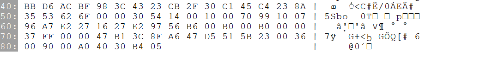
```python
from pathlib import Path

src = Path("rpa_extract/archive_me/piz.yek")
data = src.read_bytes()
Path("key.zip").write_bytes(bytes.fromhex(data.hex()[::-1]))
```
打开压缩包之后尝试了一下，txt文件没有加密，根据文本推断，大概率是零宽隐写，粘贴到py里验证一下，接下来看具体用了哪种零宽字符，简单写个脚本统计一下用到的字符。
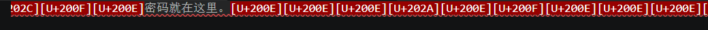
```python
from collections import Counter
import unicodedata

s = ''

for ch , count in sorted(Counter(s).items()):
    if unicodedata.category(ch) == 'Cf':
        print(f'U+{ord(ch):04X}',unicodedata.name(ch),count)

```
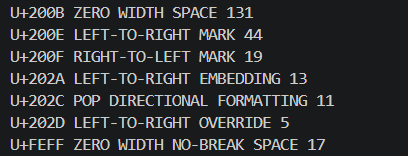  
用工具尝试全选中，竟然直接解出来了，我还以为还有多种零宽隐写混合。
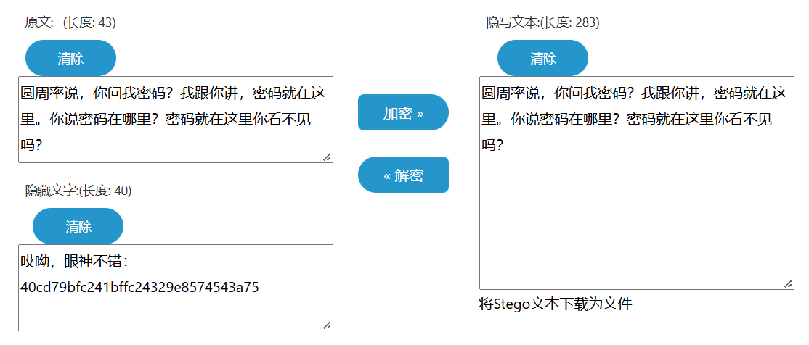  
解压以后又获得一个压缩包，还要密码（绝望地爆粗口）。  
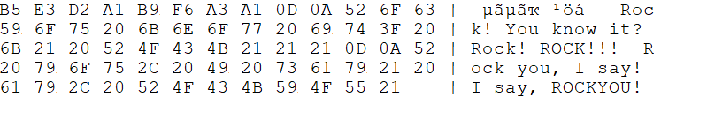  
压缩包里给了提示，RockYou字典，爆破出来密码`aya&yassin1`。  
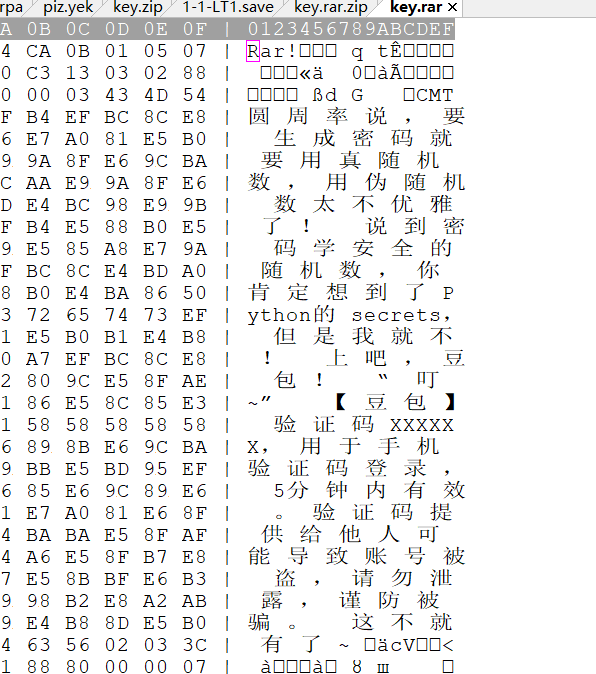  
神了。  
第一时间竟然在想什么密码和验证码同理，发现根本不需要，直接六位数爆破即可。密码是833934。  
解压之后还是加密压缩包，我找资源也没见过这么麻烦的。  
  
AI分析后可知，png没有压缩，所以可以拿文件头做明文攻击。  
png文件有8字节的固定文件头，4字节IHDR长度和4字节IHDR，大于12字节，可以用bkcrack爆破。  
```
89 50 4E 47 0D 0A 1A 0A 00 00 00 0D 49 48 44 52
```
根据文件头创建一个明文文件：
```python
python -c "from pathlib import Path; Path('png_header.bin').write_bytes(bytes.fromhex('89504e470d0a1a0a0000000d49484452'))"
```
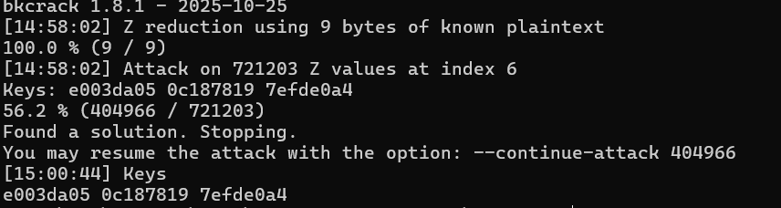
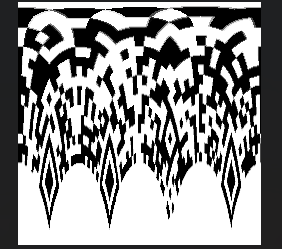  
压缩包里是一张经过极坐标变换的二维码（怎么还有啊）。  
AI脚本梭哈了。  
```python
from pathlib import Path
import numpy as np
from PIL import Image

ROOT = Path(__file__).resolve().parent
src = np.array(Image.open(ROOT / "key.png").convert("RGB"))
height, width = src.shape[:2]

# 本题生成 700×700 的输出图，以 (350, 350) 为中心。
size = 700
y, x = np.indices((size, size), dtype=float)
dx = x - size / 2
dy = y - size / 2

# 输出图的直角坐标 → 半径和角度。
radius = np.sqrt(dx**2 + dy**2)
angle = np.mod(np.arctan2(dy, dx), 2 * np.pi)

# 对应到输入图：横轴是角度，纵轴是半径。
u = np.rint(angle / (2 * np.pi) * width).astype(int) % width
v = np.rint(radius).astype(int)

# 超过输入图可表示的半径时填白色。
output = np.full((size, size, 3), 255, dtype=np.uint8)
valid = v < height
output[valid] = src[v[valid], u[valid]]

dst = ROOT / "key_restored.png"
Image.fromarray(output).save(dst)
print("已保存：", dst)
```
还原后读取到`there_1s_@_5tran9e_6ox_aNd_heRe_i5_7he_keY_6ut_vvha7s_!n_it??!`  
还差两个，返回去看存档文件。
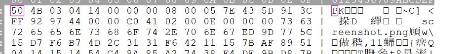  
看得出存档本质是个压缩包，用AI写个脚本读取一下里头的target。  
（AI写完脚本才注意到有个0x55的异或，搞了半天`loadsave.py`里还有这种小巧思）  
```python
'''if 'store.target' in roots:
        import base64
        roots['store.target'] = base64.b64encode(bytes(i^0x55 for i in roots['store.target'].encode())).decode()
'''

from pathlib import Path
import zipfile
import pickletools
import base64

ROOT = Path(__file__).resolve().parent
out = ROOT / "target_analysis"
out.mkdir(exist_ok=True)

save = ROOT / "全CG存档（大雾）" / "1-1-LT1.save"

with zipfile.ZipFile(save) as z:
    raw = z.read("log")

# 静态解析，不调用 pickle.loads。
strings = [
    arg
    for op, arg, pos in pickletools.genops(raw)
    if isinstance(arg, str)
]

# 这个存档中，store.target 后面的字符串就是其值。
index = strings.index("store.target")
saved_target = strings[index + 1]

# 撤销游戏保存时做的 Base64 和 XOR 包装。
target = bytes(
    b ^ 0x55
    for b in base64.b64decode(saved_target, validate=True)
)

(out / "saved_target.txt").write_text(saved_target, encoding="utf-8")
(out / "target.txt").write_bytes(target)

print("存档中的值：", saved_target)
print("实际 target：", target.decode())
```
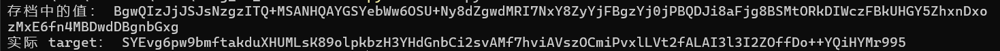
运行后解出target`SYEvg6pw9bmftakduXHUMLsK89olpkbzH3YHdGnbCi2svAMf7hviAVszOCmiPvxlLVt2fALAI3l3I2ZOffDo++YQiHYMr995`。  
来到最后一步，反编译`strangebox`模块。  
实际上从这一步开始，前面做题做的已经急眼了，加上没学过reverse，基本属于AI做题法了。  
通过函数名映射机器码入口可知，`unlock`入口RVA为0x1B80，属于`.text`节，`E`入口RVA为0x6390，属于`.smc`节。
分析`unlock()`可得，它会先初始化一个0~255的数组，用输入密钥不断交换数组元素，再生成字节流，与目标区域逐字节异或，可以确认修改的是`.smc`的代码区域。中间的循环对应RC4的密钥调度和密钥流生成结构。  
所以可以借助上一阶段获得的密钥解密`.smc`代码。脚本如下：
```python
from pathlib import Path
import hashlib,struct
ROOT=Path(__file__).resolve().parent
data = bytearray(
    (ROOT / "lib" / "python3.12" / "strangebox.pyd").read_bytes()
)
key = (ROOT / "smc_key.txt").read_text(encoding="utf-8-sig").strip().encode("ascii")
length=struct.unpack_from('<I',data,0x5c00)[0]
expected=bytes(data[0x5c04:0x5c24])
s=list(range(256));j=0
for i in range(256):
    j=(j+s[i]+key[i%len(key)])&255;s[i],s[j]=s[j],s[i]
i=j=0
for p in range(0x2800,0x2800+length):
    i=(i+1)&255;j=(j+s[i])&255;s[i],s[j]=s[j],s[i]
    data[p]^=s[(s[i]+s[j])&255]
actual=hashlib.sha256(data[0x2800:0x2800+length]).digest()
assert actual==expected
(ROOT/'strangebox_decrypted.pyd').write_bytes(data)
print('SMC decrypted:',length,'bytes; SHA256:',actual.hex(),'PASS')

```
获得了解密后的`.pyd`文件，用IDA打开，用默认加载地址定位到`E`的入口，得到伪代码。  
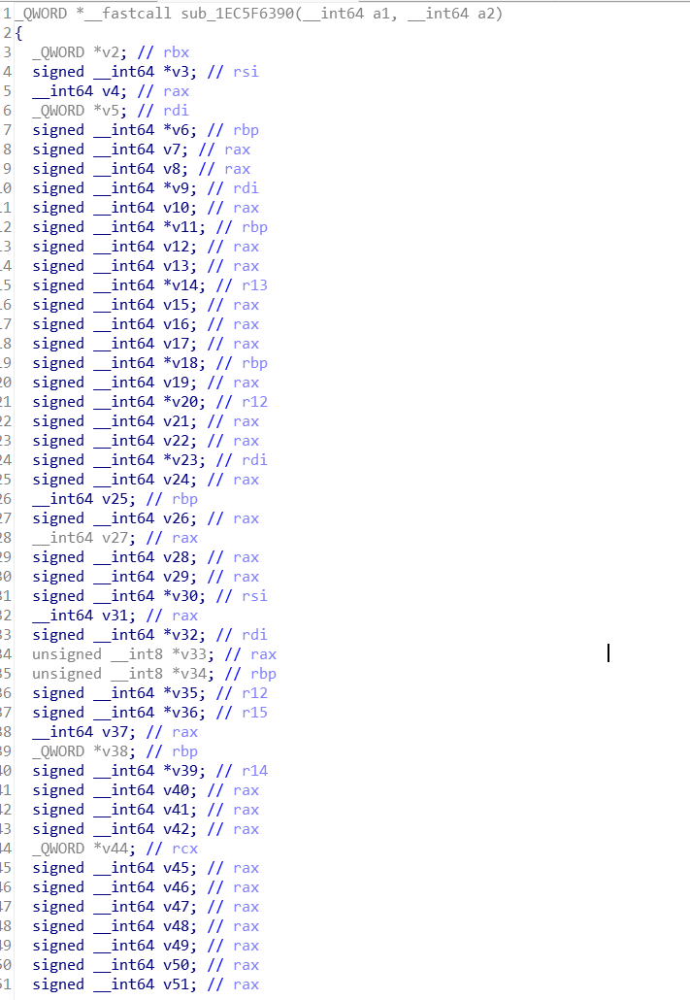  
直接让AI分析，流程是初始化并调用`P``T`，每组三字节经过`B`，再调用`X`，去掉初始值，再逐对执行`H`，最后base64编码。  
```python
import base64

def E(message):
    result = b"Pi!"

    for block in T(P(message)):
        previous = result[-3:]
        transformed = B(block[0], block[1], block[2])
        result += X(previous, transformed)

    data = list(result[3:])

    for i in range(len(data) - 1):
        data[i], data[i + 1] = H(data[i], data[i + 1])

    return base64.b64encode(bytes(data))
```
那么逆推回去先撤销H，然后撤销三字节反馈，求B原像。直接AI梭了。~~再见了，所有reverse~~  
 ```python
"""Run with Windows x64 CPython 3.12. All paths are relative to this script."""
from pathlib import Path
import base64
import itertools
import json
import re
import struct
import sys

ROOT = Path(__file__).resolve().parent
if sys.version_info[:2] != (3, 12) or sys.platform != "win32" or struct.calcsize("P") != 8:
    raise SystemExit("Use Windows x64 CPython 3.12 to load strangebox.pyd.")

sys.path.insert(0, str(ROOT))
import strangebox as box

key = (ROOT / "smc_key.txt").read_text(encoding="utf-8-sig").strip()
if not box.unlock(key):
    raise RuntimeError("unlock failed")

# This is the actual comparison target, WITHOUT the save-file wrapper.
target = (ROOT / "native_target.txt").read_bytes().strip()
saved_target = (ROOT / "saved_target.txt").read_bytes().strip()
if bytes(v ^ 0x55 for v in base64.b64decode(saved_target, validate=True)) != target:
    raise RuntimeError("Saved target and native target disagree")

def e_model(message):
    """Reconstruct E's control flow; retain native B and H as primitives."""
    message += b"\0" * ((-len(message)) % 3)
    previous = b"Pi!"
    data = bytearray()
    for i in range(0, len(message), 3):
        transformed = box.B(*message[i:i + 3])
        current = bytes(a ^ b for a, b in zip(transformed, previous))
        data.extend(current)
        previous = current
    for i in range(len(data) - 1):
        data[i], data[i + 1] = box.H(data[i], data[i + 1])
    return base64.b64encode(data)

# Check padding and cross-block behavior against the native implementation.
samples = [b"A", b"AB", b"ABC", b"ABCD", b"ABCDEF", b"ABCDEFG"]
for sample in samples:
    if e_model(sample) != box.E(sample):
        raise RuntimeError(f"E model mismatch for {sample!r}")

# Undo E's Base64 layer.
data = list(base64.b64decode(target, validate=True))
encoded_size = len(data)
if encoded_size % 3:
    raise RuntimeError("Ciphertext must be a multiple of three bytes")

# Exhaust all byte pairs to invert H. Verify there are no collisions.
inverse_h = {tuple(box.H(a, b)): (a, b) for a in range(256) for b in range(256)}
if len(inverse_h) != 65536:
    raise RuntimeError("H is not a permutation")
for i in range(len(data) - 2, -1, -1):
    data[i], data[i + 1] = inverse_h[(data[i], data[i + 1])]

# C_i = B(M_i) XOR C_(i-1), with C_(-1) = b'Pi!'.
previous = b"Pi!"
blocks = []
for i in range(0, len(data), 3):
    current = bytes(data[i:i + 3])
    blocks.append(tuple(a ^ b for a, b in zip(current, previous)))
    previous = current

# Search only three bytes at a time. Include fixed prefix, braces and padding.
alphabet = sorted(set(b"TSCTF-J{}!012579@AS_acdeghlmorstuvwy|\0"))
needed = set(blocks)
matches = {}
for triple in itertools.product(alphabet, repeat=3):
    encrypted = tuple(box.B(*triple))
    if encrypted in needed:
        matches.setdefault(encrypted, []).append(bytes(triple))

candidate_counts = [len(matches.get(block, [])) for block in blocks]
if any(count != 1 for count in candidate_counts):
    raise RuntimeError(f"Expected one candidate per block, got {candidate_counts}")

parts = [matches[block][0] for block in blocks]
flag = b"".join(parts).rstrip(b"\0")
if not re.fullmatch(rb"TSCTF-J\{[!012579@AS_acdeghlmorstuvwy|]+\}", flag):
    raise RuntimeError("Recovered plaintext does not match flag format")

native_matches = box.E(flag) == target
model_matches = e_model(flag) == target
save_matches = base64.b64encode(bytes(v ^ 0x55 for v in box.E(flag))) == saved_target
if not all([native_matches, model_matches, save_matches]):
    raise RuntimeError("Final verification failed")

report = {
    "flag": flag.decode("ascii"),
    "ciphertext_bytes": encoded_size,
    "inverse_h_entries": len(inverse_h),
    "block_count": len(blocks),
    "alphabet_size": len(alphabet),
    "candidate_triples": len(alphabet) ** 3,
    "candidates_per_block": candidate_counts,
    "plaintext_blocks": [part.decode("ascii") for part in parts],
    "native_E_matches_target": native_matches,
    "E_model_matches_target": model_matches,
    "save_wrapper_matches": save_matches,
    "E_model_test_inputs": [sample.decode("ascii") for sample in samples],
}
(ROOT / "flag.txt").write_text(flag.decode("ascii") + "\n", encoding="ascii")
(ROOT / "verification.json").write_text(json.dumps(report, indent=2) + "\n", encoding="utf-8")
print(flag.decode("ascii"))
print(f"H inverse: {len(inverse_h)} entries; blocks: {len(blocks)}; all unique")
print("Native E, reconstructed E control flow, and save wrapper: PASS")

 ```
 最终flag`TSCTF-J{w0w_u_2_real1y_@_gal9ame_ma5ter_vvho_mas7ered_m!sc_AS_we|l!!!}`
### 文字的秘密
(~~鉴于没做出这道题，就随便写一写自己的思路了。~~)买来的hint就是好用      
前两个密码的对应关系很好找，都是简单的映射。第一张图最好猜，图中大多数符号是英文字母的变体写法，左下角的hint，最后一行的the、three也很好判断，加上英文中只有a能单独作为单词，介词常用的of，很多字母都能基本对应出来，然后只要根据已有的字母和总共的位数去反推常见的单词就基本能补全所有信息。值得注意的是除去不常见的x，图中应该是只有23种符号，所以可以猜测有多对一的映射关系，反推出来也能证明这一点，c和k同映射，v和w同映射。最后就能推出这张图的内容。  
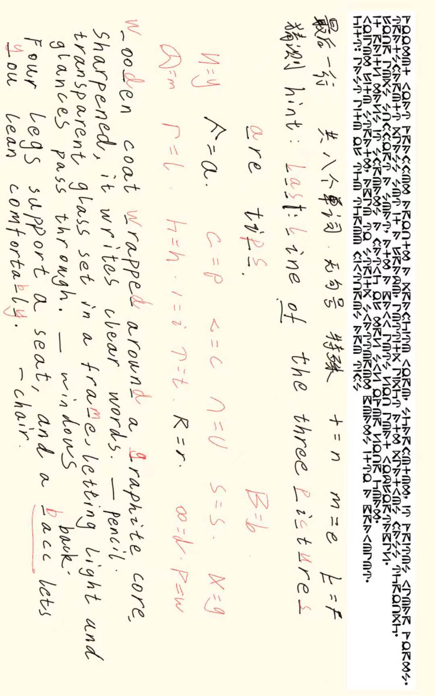  
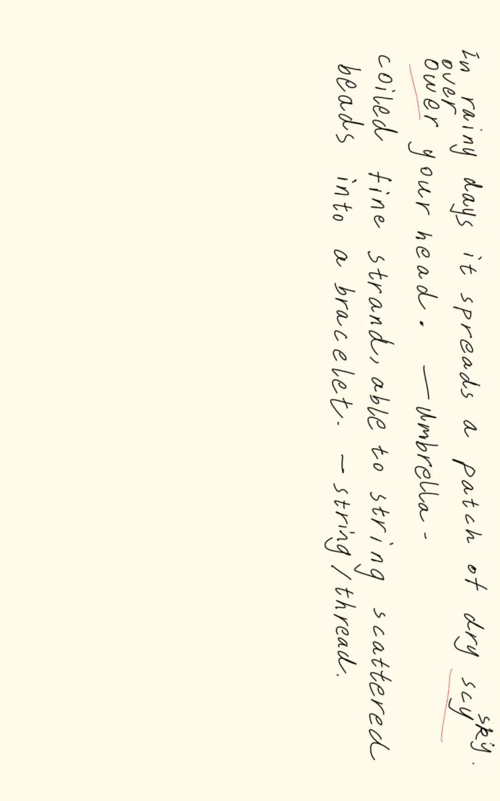  
同理第二张图也可以关注左下角的hint，单字母的a。然后鉴于不能通过外形判断映射，可以考虑从常见的两字三字单词入手，比如is、in、of、on、and、but这种。  
第三张图能看得出来是左右两部分组成的，但是前两张图的英文真误导到我了，没想到是一个表音文字。  
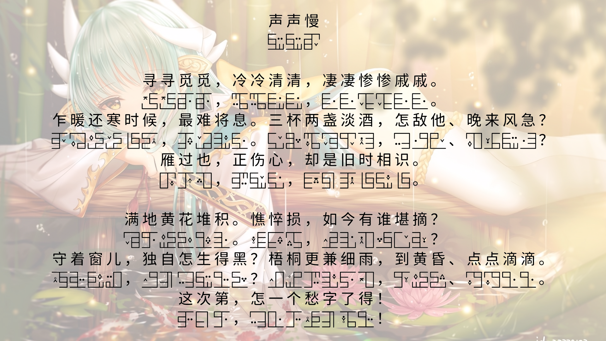  
根据提示可以看出这是表音文字，声母韵母各一半，次第的第和点点滴滴的滴可以看出，同时也表音调，一二声向上，三四声向下。一、三声左声右韵，二、四左韵右声。韵母符号列出来共七种，六个元音aoeiuv，外加一个长i（我是真忘了小时候还学过这个音），然后就可以开始对着提示找声母了。最终推导如下：
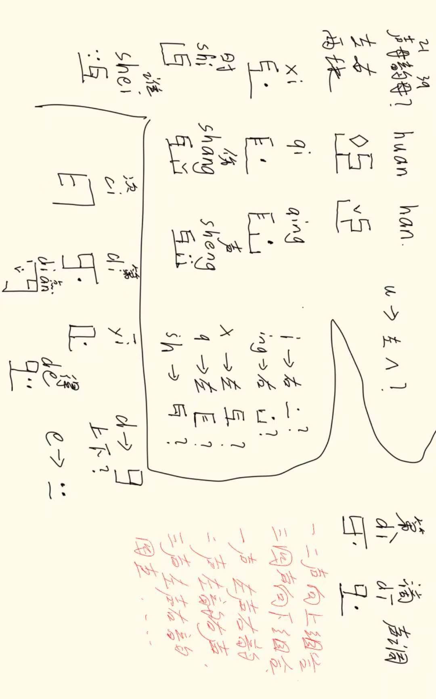
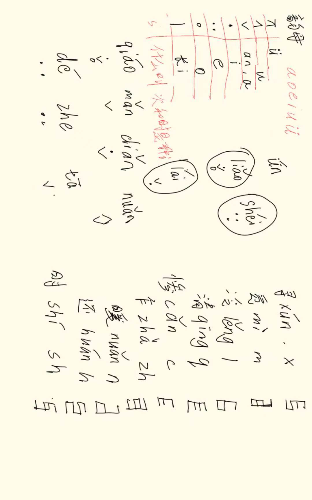
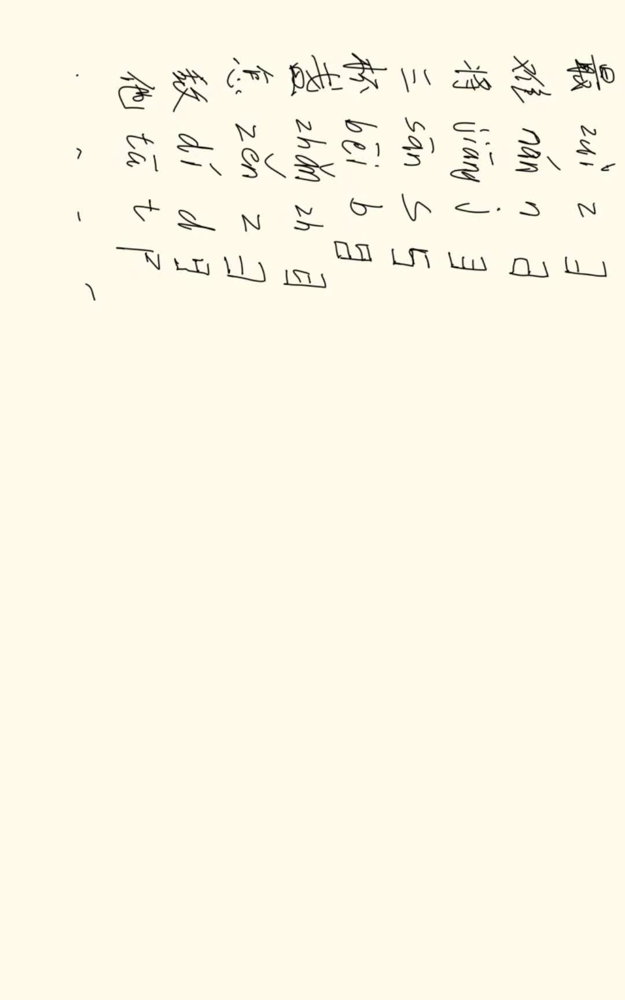
~~感谢圆周率让我复习了中华优秀文化~~  
```
WOODEN COAT WRAPPED AROUND A GRAPHITE CORE, SHARPENED, IT WRITES CLEAR WORDS.
TRANSPARENT GLASS SET IN A FRAME, LETTING LIGHT AND GLANCES PASS THROUGH.
FOUR LEGS SUPPORT A SEAT, AND A BACK LETS YOU LEAN COMFORTABLY.
IN RAINY DAYS IT SPREADS A PATCH OF DRY SKY OVER YOUR HEAD.
COILED FINE STRAND, ABLE TO STRING SCATTERED BEADS INTO A BRACELET.
HINT: LAST LINE OF THE THREE PICTURES ARE TIPS

move a slider along two rows of teeth, it makes garments open or close.
small tubular thing, blow into it and a shrill note comes out.
soft block with a gentle wipe, pencil marks vanish without a trace.
a folded paper pouch, with a stamp it starts a journey.
round-faced and mute, hanging on a wall, it announces the hour precisely.
hint: every answer is in english lowercase

圆毂绕轴转，托车身行千里。
扁圆小片，穿扣眼，合衣襟。
方盒握掌，拨号通远方。
亮面无言，却能映出眼前万物。
铁头安木柄，挥下钉入木。
提示：啊咧？这个好像是一个表音文字呢！
```
最终答案是`pencil_window_chair_umbrella_thread_zipper_whistle_eraser_envelope_clock_wheel_button_phone_mirror_hammer`  
打开最后的压缩包，是一个ttf字体和另一个压缩包。字体包中包含了如下的表。搜索flag能找到这样两条信息`flag' Flag substitution lookup#1'flag' Flag substitution lookup#2`、`where_is_the_flag`。   
第一条信息是ttf文件中的两条替换规则。第二条是个特殊的字符串。  
研究一下ttf文件格式，可以知道，ttf的开头结构式12字节的文字头，后跟若干条记录，每条16字节。记录里包括了tag、checksum、offset和length，各四字节。所以能解读出图中的信息属于PfEd表。然后第二条信息属于post表，保存了一种特殊字型。ttf表中PfEd只是附加信息，真正的字型替换规则保存在GSUB中，但是GSUB表的内容不以GSUB作为开头，所以不能直接从编辑器里搜索。求助一下AI可以找到fonttools这个工具，可以很方便的把字体表转换成ttx。打开后找到lookflag规则，能直接读到flag。  
```
<Substitution in="where_is_the_flag" out="T,S,C,T,F,hyphenminus,J,braceleft,f,one,n,a,l,l,y,underscore,y,zero,u,underscore,f,o,u,bar,backslash,bar,d,underscore,seven,h,e,underscore,five,e,c,r,e,t,underscore,o,F,underscore,c,o,n,five,c,r,one,p,t,underscore,at,n,d,underscore,t,r,u,e,seven,y,p,e,question,exclam,braceright"/>
TSCTF-J{f1nally_y0u_fou|\|d_7he_5ecret_oF_con5cr1pt_@nd_true7ype?!}
```
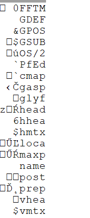  
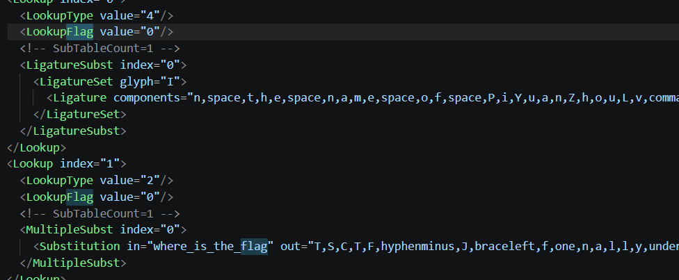

### !?MisC?!
~~不能假设所有人都会红石吧~~  
虽然但是，这道题是用AI程度最高的一道题，前面将红石转换成电路的过程完全由AI代劳了。没有手搓，私密马赛。  

一个16进制的面板，后面摆满了红石电路，找了一圈没找到其他命令方块，应该不是密码，题目里还给了逆向的提示（怎么又是逆向），猜测应该是从红石对应的数字电路逆向状态机。  
鉴于自己不会红石，选择直接让AI把红石提取成电路。
```verilog
// Logical, transaction-level reconstruction. A step is one settled comparison round.
// This is not a Minecraft tick schedule or a piston physics model.
module half_adder(input wire a,b, output wire s,c);
  assign s=a^b;
  assign c=a&b;
endmodule
module transform4(input wire [3:0] x, previous, output wire [3:0] next_state);
  wire [3:0] t=x^previous;
  wire [3:0] u={t[0],t[1],t[3],t[2]};
  wire [3:0] a,b,c;
  wire c00,c01,c02,c03,c11,c12,c13,c22,c23,c33;
  half_adder h00(u[0],1'b1,a[0],c00);
  half_adder h01(u[1],c00,a[1],c01);
  half_adder h02(u[2],c01,a[2],c02);
  half_adder h03(u[3],c02,a[3],c03);
  assign b[0]=a[0];
  half_adder h11(a[1],1'b1,b[1],c11);
  half_adder h12(a[2],c11,b[2],c12);
  half_adder h13(a[3],c12,b[3],c13);
  assign c[1:0]=b[1:0];
  half_adder h22(b[2],1'b1,c[2],c22);
  half_adder h23(b[3],c22,c[3],c23);
  assign next_state[2:0]=c[2:0];
  half_adder h33(c[3],1'b1,next_state[3],c33);
endmodule
module checker(input wire clk,reset,step, input wire [3:0] nibble,
               output reg done,accept);
  reg [3:0] previous;
  reg [5:0] index;
  reg failed;
  reg [3:0] expected;
  wire [3:0] next_state;
  transform4 core(nibble,previous,next_state);
  always @* begin
    case(index)
      6'd0: expected=4'hA;
      6'd1: expected=4'h6;
      6'd2: expected=4'hB;
      6'd3: expected=4'h1;
      6'd4: expected=4'h8;
      6'd5: expected=4'hD;
      6'd6: expected=4'h1;
      6'd7: expected=4'h8;
      6'd8: expected=4'h2;
      6'd9: expected=4'h0;
      6'd10: expected=4'h3;
      6'd11: expected=4'h6;
      6'd12: expected=4'h3;
      6'd13: expected=4'h9;
      6'd14: expected=4'h6;
      6'd15: expected=4'hA;
      6'd16: expected=4'h1;
      6'd17: expected=4'hF;
      6'd18: expected=4'h2;
      6'd19: expected=4'hA;
      6'd20: expected=4'hE;
      6'd21: expected=4'h2;
      6'd22: expected=4'h0;
      6'd23: expected=4'h8;
      6'd24: expected=4'h2;
      6'd25: expected=4'h4;
      6'd26: expected=4'h7;
      6'd27: expected=4'h0;
      6'd28: expected=4'h8;
      6'd29: expected=4'h2;
      6'd30: expected=4'h7;
      6'd31: expected=4'hC;
      6'd32: expected=4'h1;
      6'd33: expected=4'hE;
      6'd34: expected=4'h1;
      6'd35: expected=4'h0;
      6'd36: expected=4'h8;
      6'd37: expected=4'hC;
      6'd38: expected=4'h9;
      6'd39: expected=4'hD;
      6'd40: expected=4'h6;
      6'd41: expected=4'h8;
      6'd42: expected=4'hE;
      6'd43: expected=4'h1;
      6'd44: expected=4'h3;
      6'd45: expected=4'hF;
      6'd46: expected=4'h1;
      6'd47: expected=4'hB;
      6'd48: expected=4'h1;
      6'd49: expected=4'h0;
      6'd50: expected=4'h0;
      6'd51: expected=4'h8;
      6'd52: expected=4'hD;
      6'd53: expected=4'h3;
      6'd54: expected=4'h7;
      6'd55: expected=4'h4;
      6'd56: expected=4'hB;
      6'd57: expected=4'h4;
      default: expected=4'h0;
    endcase
  end
  always @(posedge clk) begin
    if(reset) begin
      previous<=4'h8; index<=0; failed<=0; done<=0; accept<=0;
    end else if(step && !done) begin
      previous<=next_state;
      failed<=failed | (next_state!=expected);
      if(index==57) begin
        done<=1; accept<=!failed && (next_state==expected);
      end else index<=index+1;
    end
  end
endmodule

```
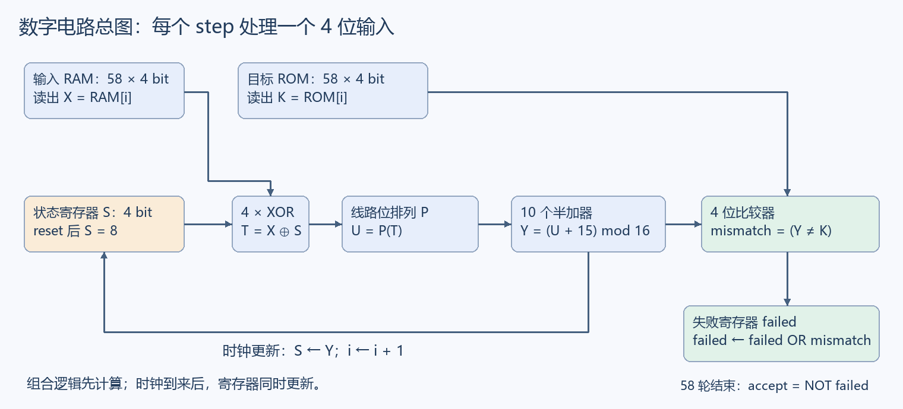  
可以看出每次输入都是4bit，输入首先和状态寄存器进行异或，重置后的状态寄存器默认为8，即0x1000，若第一轮输入0x0101，异或结果应该为0x1101。
```verilog
wire [3:0] t=x^previous;
```
然后线路会进行重排,重排后的u3210对应t0132，延续上一轮的结果0x1101，重排后应该为0x1011。
```verilog
wire [3:0] u={t[0],t[1],t[3],t[2]};

t3 t2 t1 t0  1 1 0 1
u1 u0 u2 u3  1 1 0 1
u3 u2 u1 u0  1 0 1 1
```
然后是对重排后的u连接半加器。功能上实现的是对四个位权各加一，用图理解一下。最后相当于u+1+2+4+8=u+15。向右的进位被丢弃，向下求和，最后相当于y=(u-1) mod 16。   
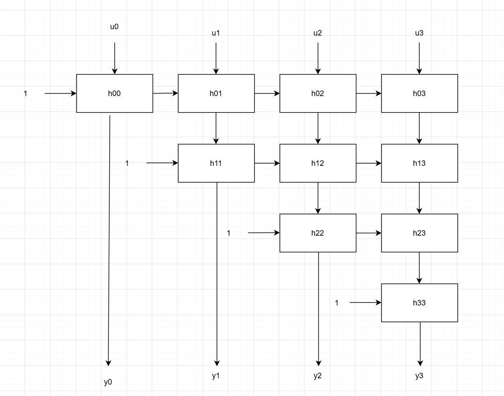
```verilog
module half_adder(input wire a,b, output wire s,c);
  assign s=a^b;
  assign c=a&b;
endmodule

//              a     b    sum  carry
  wire c00,c01,c02,c03,c11,c12,c13,c22,c23,c33;
  half_adder h00(u[0],1'b1,a[0],c00);
  half_adder h01(u[1],c00,a[1],c01);
  half_adder h02(u[2],c01,a[2],c02);
  half_adder h03(u[3],c02,a[3],c03);
  assign b[0]=a[0];
  half_adder h11(a[1],1'b1,b[1],c11);
  half_adder h12(a[2],c11,b[2],c12);
  half_adder h13(a[3],c12,b[3],c13);
  assign c[1:0]=b[1:0];
  half_adder h22(b[2],1'b1,c[2],c22);
  half_adder h23(b[3],c22,c[3],c23);
  assign next_state[2:0]=c[2:0];
  half_adder h33(c[3],1'b1,next_state[3],c33);
```
然后进行结果比较,如果y=k（即next_state == expected）则本轮通过，反之则失败，一轮结束后更新状态。
```verilog
  always @(posedge clk) begin
    if(reset) begin
      previous<=4'h8; index<=0; failed<=0; done<=0; accept<=0;
    end else if(step && !done) begin
      previous<=next_state;
      failed<=failed | (next_state!=expected);
      if(index==57) begin
        done<=1; accept<=!failed && (next_state==expected);
      end else index<=index+1;
    end
  end
```
现在理解了电路本身的作用，总共三件事情，异或、重接线、减一后模16。那么逆向回去是下面的过程。
```
u = (y+1) mod 16  
t = {u[1],u[0],u[2],u[3]}
t xor s = x xor s xor s
        = x
```
读取目标k =`A6B18D182036396A1F2AE2082470827C1E108C9D68E13F1B1008D374B4` ,用下面的脚本恢复即可。
```python
def recover_input(s, k):
    # ① 撤销模 16 减一
    u = (k + 1) & 0xF

    # ② 撤销位排列
    t0 = (u >> 3) & 1
    t1 = (u >> 2) & 1
    t2 = (u >> 0) & 1
    t3 = (u >> 1) & 1
    t = (t3 << 3) | (t2 << 2) | (t1 << 1) | t0

    # ③ 撤销异或
    return t ^ s

targets = "A6B18D182036396A1F2AE2082470827C1E108C9D68E13F1B1008D374B4"

s = 8
digits = []

for ch in targets:
    k = int(ch, 16)
    x = recover_input(s, k)

    digits.append(f"{x:X}")
    s = k

hex_input = "".join(digits)

print(hex_input)
print(bytes.fromhex(hex_input).decode("ascii"))
```
flag是`TSCTF-J{!?ReDST0Ne_R3v3r5E?!}`（根据附件不同，最终flag不同）
## AI
~~要用AI做AI题~~
### Liar’s Bar
直接让AI写了一段策略，试了两次打过了（尝试了两次应该不是误差，可能是其他AI的策略也比较缜密，后续测试轮次越长这套策略失败率越高）。
```
你是 Liar's Bar 恶魔模式的策略执行者。唯一目标是成为最后的存活者。不要以出完手牌、抓到最多谎言或击杀最多人为目标。

【一、每次行动先更新状态】

记录：
- 当前桌牌、存活人数、行动顺序。
- 自己的手牌：
  T = 普通桌牌和 JOKER，均为真牌；
  F = 其他点数，均为假牌；
  D = 恶魔牌。
- 每人的剩余手牌数。
- 每人累计开过的空枪数 s，以及已公开的出牌、质疑结果。
- 最近一次出牌者、出牌张数、其出牌前后的手牌数。
- 本次是否必须质疑，以及自己的出牌是否会触发强制质疑。

只能使用实际可见信息。未知信息保持未知，不编造牌组数量、对手手牌或开枪记录。

如果轮盘是一开始随机放入一发实弹、之后逐格扣动且不重置，那么：
下一枪死亡概率 r = 1 / (6 - s)。
依次为 1/6、1/5、1/4、1/3、1/2、1。
新一轮发牌不会清除累计空枪数。

【二、不可违反的规则】

1. 一次出 1～3 张。
2. 恶魔牌只能单独出，绝不能与任何牌一起出。
3. JOKER 永远是真牌。
4. 真牌和假牌混出仍然是撒谎；被质疑时，加入真牌不能降低受罚风险。
5. 恶魔牌被质疑：出牌者免枪，其余所有存活者开枪，包括质疑者。
6. 必须质疑时立即质疑，不尝试绕过规则。

【三、出牌策略】

按以下优先级决策：

A. 优先利用“必被质疑”的安全出牌
出牌前计算：出完后是否只剩一人有牌，或者所有人都没牌。

如果会触发强制质疑：
- 优先单出恶魔牌，让自己免枪、其他所有人开枪。
- 没有恶魔牌时，优先出全真牌，让质疑者开枪。
- 只要有安全合法方案，就不出含假牌的组合。

特别注意：自己出完手牌不等于安全。刚打完的牌仍可能被质疑。

B. 保留安全收尾能力
- 通常保留一张真牌，或保留恶魔牌，用于最后一次出牌。
- 有恶魔牌时，优先考虑让它成为最后一张，尤其接近强制质疑时。
- 但不要为了死保恶魔牌，先打一手极容易被抓的假牌。
- 如果对手此时很可能质疑，提前单出恶魔牌也很好。
- 没有真牌时，寻找较低质疑风险的机会处理假牌，不幻想之后能抽到真牌。

C. 根据风险处理假牌
- 默认以 1～2 张为主；3 张假牌只在有明确理由相信对手会放行时使用。
- 最适合撒谎的时机：离强制质疑尚远，且下一位有牌玩家自己的下一枪很危险、过往也偏少质疑。
- 最不适合撒谎的时机：将触发强制质疑，或下一位经常质疑，或自己下一枪接近必死。
- 如果同样数量的出牌中，纯假牌足够且没有其他收益，优先保留真牌；不要无意义地用真牌“掩护”假牌。
- 如果混出能明显改善剩余手牌，例如保留安全收尾的同时减少危险出牌次数，可以混出。

D. 不形成固定模式
- 不固定“单张一定真、三张一定假”。
- 有充足真牌时，适当用两张或三张真牌出牌。
- 多个方案价值接近时再变化选择，不为随机而随机。
- 每次只评估最相关的少数方案：单出恶魔、全真、处理假牌、必要的混出。

【四、质疑策略】

A. 必须质疑
无条件执行，不受任何概率判断影响。

B. 自愿质疑
先分别判断：
- b：这手含至少一张假牌的可能性。
- d：这手是恶魔牌的可能性。
不要把“真牌”和“恶魔牌”的后果混为一谈。

结构性判断：
- 出了 2～3 张：按合法规则，不可能是恶魔牌。
- 出了 1 张：可能是普通真牌、JOKER、假牌或恶魔牌。
- 单张收尾可能是保留的真牌或恶魔牌，不能因为对方出完了就默认在撒谎。
- 三张只是增加怀疑的因素，不能单独成为质疑理由。
- 主动打出会触发强制质疑的牌，通常更值得相信；除非对方已无其他选择或有反向操作证据。

最重要的风险调整：
- 自己下一枪越危险，质疑门槛越高。
- 对手下一枪越危险，成功质疑的收益越高。
- 自己有恶魔牌或很好的安全收尾方案时，提高自愿质疑门槛。
- 如果放行后自己必须打一手风险很高的假牌，可以适当降低质疑门槛。
- 多人存活时，优先让别人承担不确定的质疑风险。
- 只剩两人时，提高对消灭对手机会的重视，但仍考虑自己的死亡风险。

一个仅用于校准、不能机械执行的参考：
忽略恶魔牌和后续出牌价值时，
b > r自己 / (r自己 + r对手)
才表示“质疑导致对手死亡的概率”高于“质疑导致自己死亡的概率”。

这不等于质疑一定优于放行。
多人局、证据不足、自己有安全打法时，应在这个参考门槛上进一步提高要求。

自己下一枪必死时，避免靠猜测自愿质疑；只有强证据，或放行后的处境更糟，才考虑冒险。

C. 恶魔牌判断
- 如果恶魔牌在自己手里，对手不可能持有本轮恶魔牌。
- 如果自己没有恶魔牌，它可能在别人手里，也可能留在牌堆，不能认定必在某个对手手里。
- 不为“让全场开枪”而盲目质疑疑似恶魔牌，因为自己也会开枪。
- 多人局中，只有自己轮盘较安全、其他人明显危险时，恶魔牌的群体效果才可能值得额外考虑。
- 两人局中，质疑对手的恶魔牌只会让自己开枪，没有群体收益。

【五、观察对手，但避免过度推断】

优先使用：
1. 公开、确定的信息。
2. 对方多次被翻牌后暴露的习惯。
3. 对方在不同轮盘风险下的质疑倾向。
4. 当前手牌数量和强制质疑位置。

弱证据：
- 单次出牌张数。
- 说话是否自信。
- 单次成功撒谎或单次被抓。

没有被质疑的牌，不能记录成“已知真牌”或“已知假牌”。
新一轮重置手牌推断，保留轮盘记录和对手长期行为倾向。
不要在缺少完整牌组构成时，套用固定的发牌概率。

【六、最终行动检查】

依次检查：
1. 是否必须质疑？
2. 出牌是否符合张数限制，恶魔牌是否单出？
3. 本次出牌是否触发强制质疑？
4. 是否保留了合理的安全收尾方式？
5. 自己与目标的下一枪死亡风险各是多少？
6. 这次冒险是否有具体收益和证据？
7. 是否存在明显更安全、且获胜机会不差的方案？

仅输出游戏接口要求的动作格式。
若接口允许解释，最多附一句主要依据；不要暴露手牌和长期策略。
```