# moectf2026解题记录
## 碎碎念
好久没有写博客了，之前一直在忙比赛的事情，这两天终于有空回来学习古法ctf。这次做moe先做了misc，如果后面有时间的话应该会去做一点越狱之类的。说实话，moe的misc质量真的感觉的出来要比其他一些比赛好，整个逻辑过程非常完善，需要对脑电波的题目不多。这次做到霜雪千年这道题之后感觉惊为天人，环环相扣，遂觉得必须来写博客记录。  
二编：在moe收官之前突然有了点别的事情，很多题没来得及写wp，只能写了啥放啥了，有机会的话再回去复现一下。
## 霜雪千年
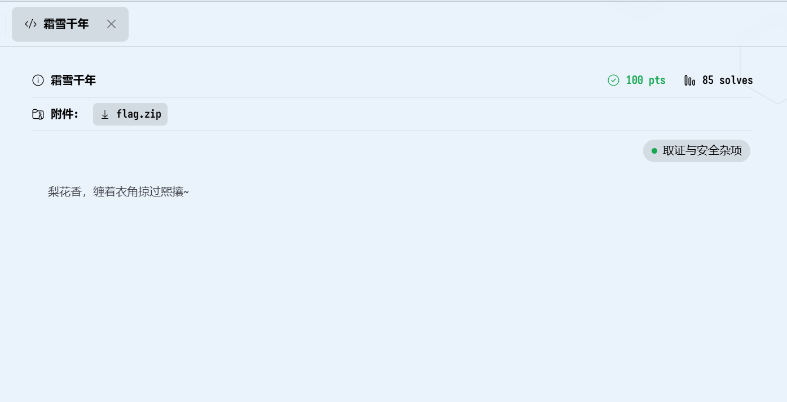
下载解压后发现是一个嵌套了1000层的压缩包（对应了题目中的千年），且同时包含了`7z`、`tar.gz`、`zip`三种压缩方式。我的处理方法是用win自带的`tar`打包压缩工具写一个循环解压1000次的脚本。  
在win11中系统默认自带`tar`，这种工具支持多种压缩格式（暂时没找到具体支持哪些格式），具体的使用方法会在后文补充。
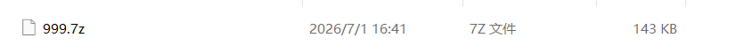
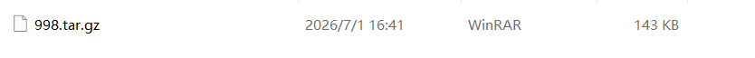
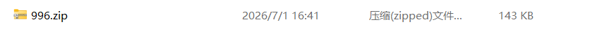
直接在powershell中写脚本，脚本大致思路是创建文件夹名、根据名字创建文件夹、将上一个文件夹中的压缩包解压到这个文件夹。因为我懒，所以选择把1000个文件夹全铺开，也可以把文件夹嵌套，然后用递归指令打开最后的密文。    
脚本如下：
```powershell
$root = 'C:\ctf\unzip'
$n = 0
$cur = join-path $root ('1000.7z')


while ($cur) {
    $pad = $n.tostring('D4')
    $folder = join-path $root ($pad)
    new-item -itemtype directory -force -path $folder | out-null
    tar -xf $cur -C $folder
    if ($lastexitcode -ne 0) {break}
    $inside = get-childitem -literalpath $folder -file | select-object -first 1
    $cur = $inside.fullname
    $n++
}

```
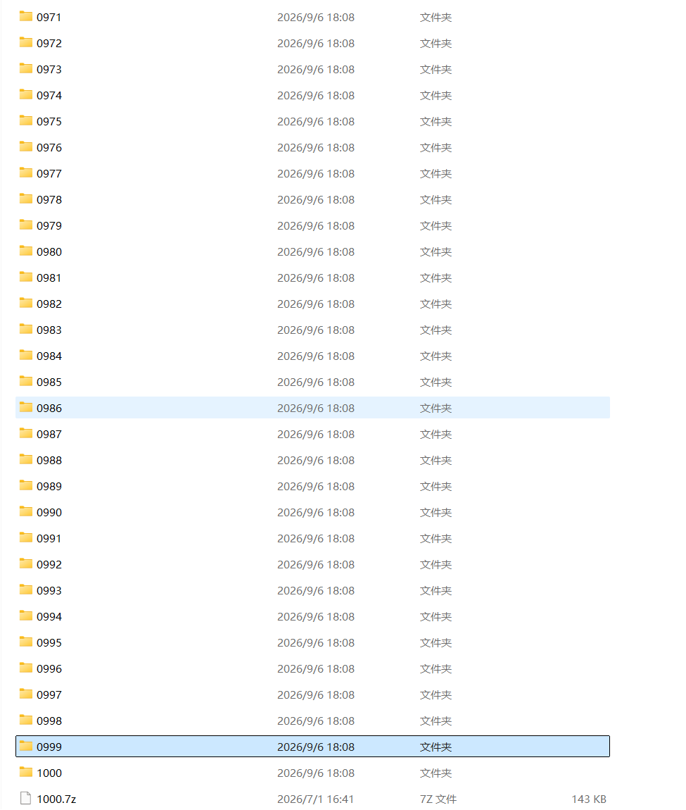
因为手动解压了一层，所以实际密文在0999文件夹。  
打开文件看到一句歌词加上一整片空白密文，所以大概率是某种whitespace加密。这里借助了AI大人帮我识别这是哪一种，得知是SNOW隐写（SNOW隐写对应了题目中的霜雪）。  
这里本来应该介绍一下这种隐写方式的原理的，但是我还没找到详细的原理论述的资料，所以只能先空着了。  

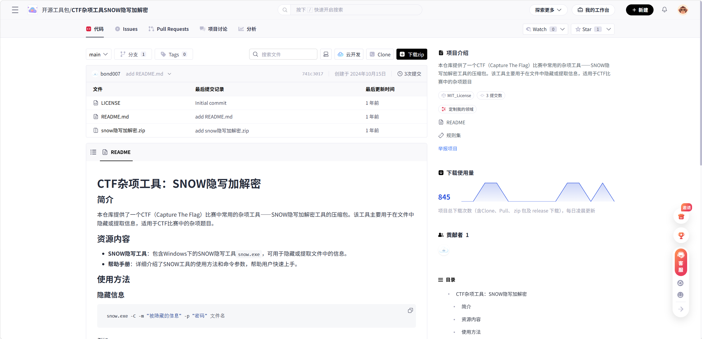
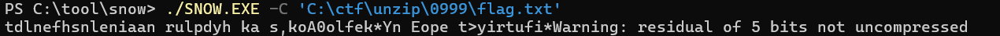
从网上下载到SNOW隐写的解密工具，直接解密发现是乱码，所以可以肯定这段信息用密钥加密过。而本题密钥的设计我觉得堪称精彩。还记得本题题目是什么吗，《霜雪千年》，题目给出的提示是`梨花香，缠着衣角掠过熙攘~`，密文中可读的信息则是`愿今生再相见`，搜索一下霜雪千年的歌词，你会发现，可读信息应该还有后半句：`消融你眉间悲戚霜雪`，这正是本题的密钥，用工具解密可得本体flag。（需要注意的是，老版本的解密工具不支持中文密钥，需要编码为utf-8使用，这一步我是让AI解决的）  
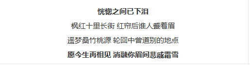
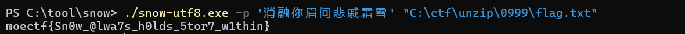
这道题化用了霜雪千年这首歌，题目始于歌曲的第一句歌词，终于歌曲的最后一句歌词，用题目点明考点，把密钥设计为歌词，解密的过程又巧妙的和最歌词中的消融霜雪呼应，不可谓不是一道好题。
## Can_you_find_it?
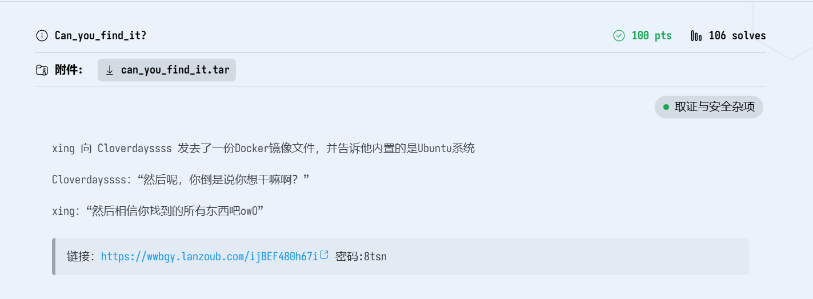
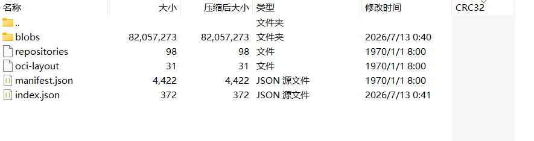
题目给了一个压缩包，解压以后可以得到一份docker镜像。  
其中`manifest.json`记录镜像名称、配置文件位置、镜像层顺序。  
`blobs/sha256`以哈希值的形式存放配置和镜像层。  
虽然我不会用docker，但是根据git操作那道题，这道题应该不是很复杂，先检查一下镜像的构建记录。  
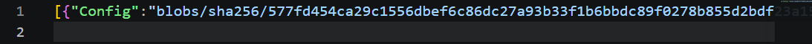
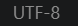
```powershell
#manifest.json文件用UTF-8编码，我用的powershell 5.1默认按ANSI编码。
$m = (get-content ./manifest.json -raw -encoding UTF8 | convertfrom-json)[0]
$config = get-content $m.config -raw -encoding UTF8 | convertfrom-json
$config.history.created_by
```
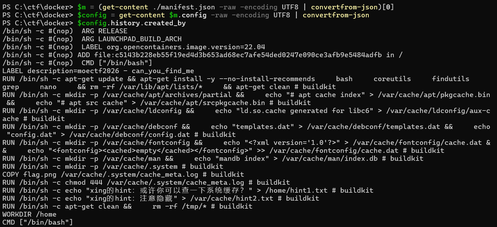
这里已经可以看到两行提示了，但是再看一眼就能看到`flag.png`，图片被放到`/var/cache/.system/`文件夹下并被改了名。
```powershell
tar -xf $m.Layers[8] -C .\ var/cache/.system/
```
  
二维码缺了两角的定位图案，我直接把左下角截下来贴上去了，扫出来就是flag。  
至于为什么是第九层呢，AI大人看出来的罢了(*^_^*)。但是如果不想用AI的话，逐层搜索即可。  
`powershell
tar -tf $m.Layers[n]
`  
但是最方便的方法其实是直接用docker查看构建历史，但是我懒得下载。
## ez_BASE_revenge
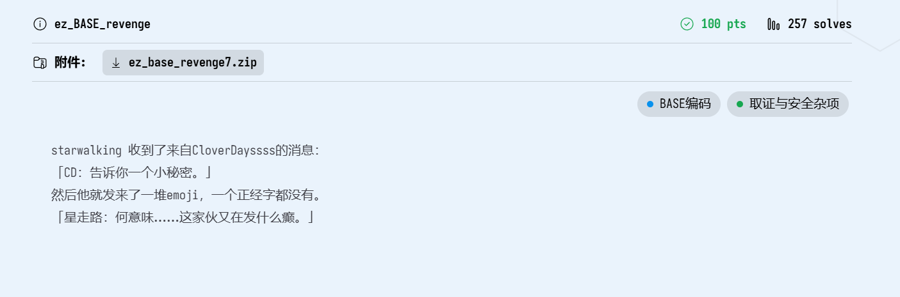
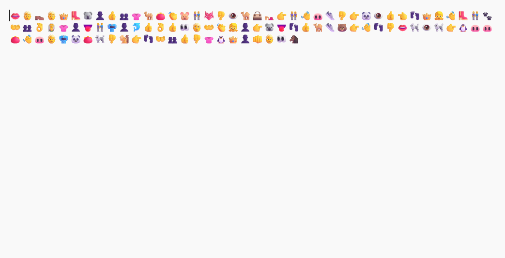
解压后是一个写满表情包的txt文件，说实话，第一次看到这段信息的时候没想出来往下做的方向。搜索一些关于BASE的编码的资料后找到了方向。
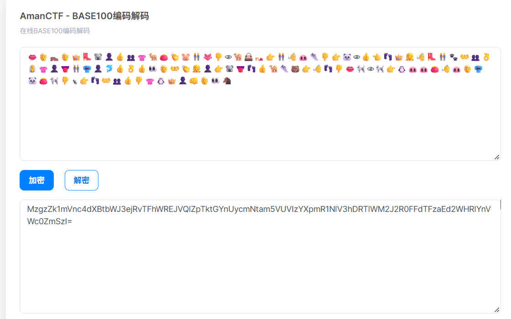
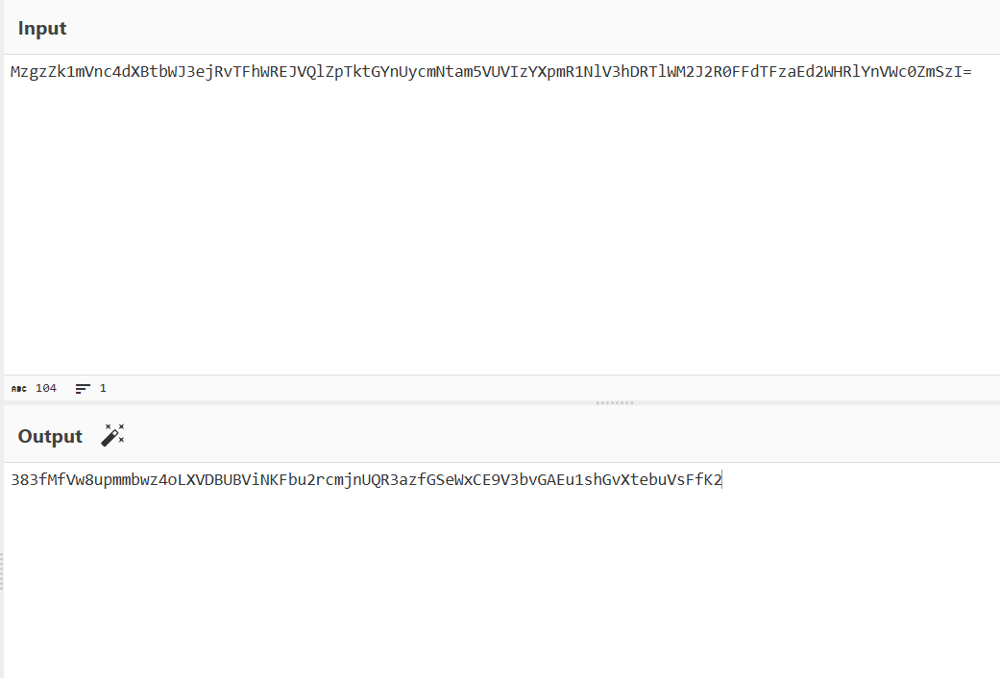
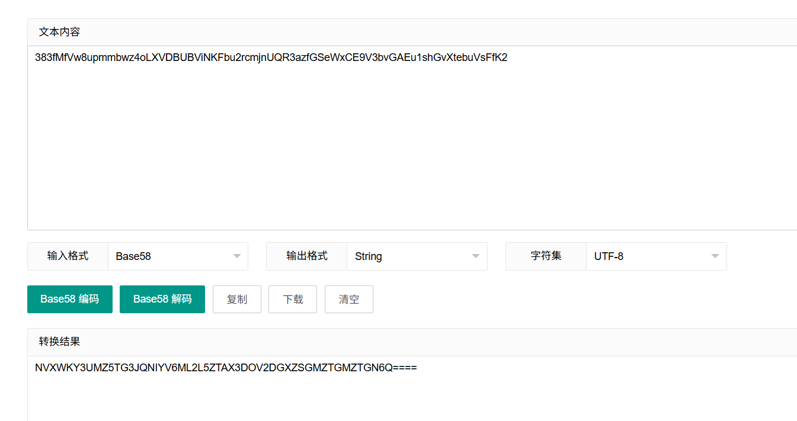
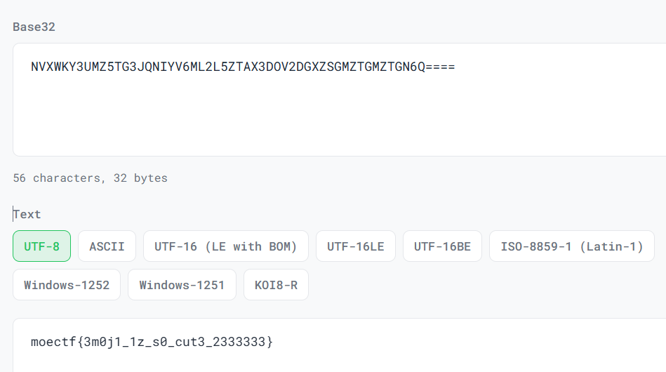
可以看出来这是一道嵌套编码，BASE100-BASE64-BASE58-BASE32。  
### 关于这四种编码
* BASE100是一种基于emoji的编码方式。它将每字节数据映射到一个特定的emoji，编码表通常包含256个不同的emoji，从0-255对应不同的字节值。最大的辨认特征就是全部由emoji组成。  
* BASE64是一种基于64个可打印字符来表示二进制数据的方法。64个字符包括`a-z`，`A-Z`，`0-9`，`+`，`/`。编码过程通常是将二进制数据分为固定大小的组，每组通常3字节，不足3字节用`=`补满，再切成4组，每组6bit，每组数值对应到字符表中的一个字符。最大的特征就是再末尾加=。
* Base58基于58个字符的字符集，相比64，去掉了`0和O`、`I和l`、`+`、`/`。编码时将二进制数据视为一个大整数，对这个大整数反复除以58并记录余数，直到商为零，最后反转生成的字符顺序获得最终的字符串。
* Base32基于32个不同字符，将二进制数据分割为5bit一组，不足用`=`填充，之后根据base32索引，进行编码，通常是`A-Z`、`2-7`。  
需要提醒的是，上述的所有编码方式的字符集都是不固定的，此外对于不同编码，也可能有特殊的编码规则，例如调整Base64的字符的顺序。所以具体情况具体分析。
## 一部电台
### 吐槽
这道题有点难评，社会主义核心价值观编码到底是哪个神人想出来的。  
### 解题过程
先听一下文件的声音，发现都是连续五声音调相同且有长有短，很容易想到是摩斯电码中的数字，~~如果打三角洲的话应该很容易听出来，大概~~。同时可以发现10个数字都出现且在四个数字之后会有一个不是很明显的长间隔，所以最终解码格式应该是4个数字为1组的超长编码。用python解码后结果如下：
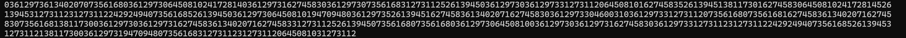
脚本是AI写的，这里就不放出来了，但是这段脚本没有打上空格，简单用正则处理一下。
```python
import re

number = '03612973613402070735616803612973064508102417281403612973162745830361297307356168312731125261394503612973036129733127311206450810162745835261394513811730162745830645081024172814526139453127311231273112242924940735616852613945036129730645081019470948036129735261394516274583613402071627458303612973304600310361297331273112073561680735616816274583613402071627458307356168138117300361297303612973162745836134020716274583312731125261394507356168073561680361297306450810036129730361297316274583036129733127311231273112242924940735616852613945312731121381173003612973194709480735616831273112312731120645081031273112'

formatted_number = re.sub(r'(\d{4})(\d{0})', r'\1 \2', number)

print(formatted_number)
```
然后考虑这段编码可能是什么，既然叫一部电台我猜测是电报电码之类的，用中文电码转换试了试发现正确，最终可以得到以核心价值观为符号的密文。
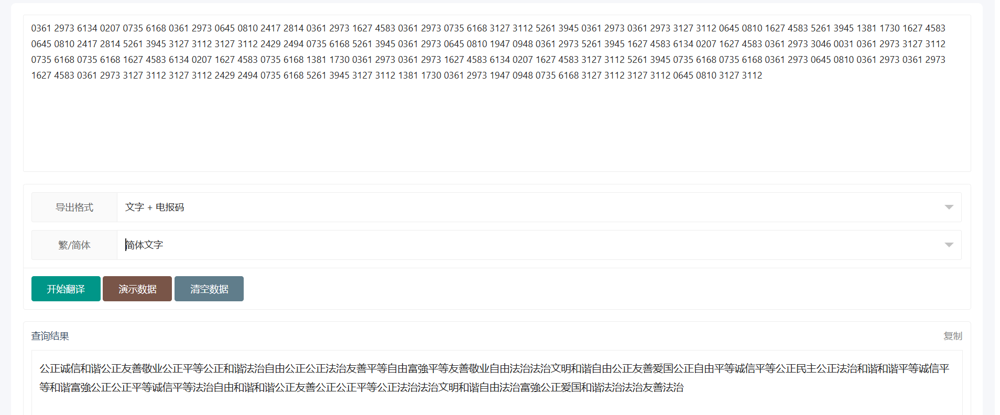
然后在这里卡了半天，遂请AI出手，发现核心价值观编码这个神奇的玩意，解码后可得最终结果。  
（想解释一下原理来着，但是用到的编码原理我看了以后觉得很不自然，有想了解的可以去https://github.com/sym233/core-values-encoder）
## 基米文件
解压后只有一个txt文件，内容是由‘哈基米’三个字组成的超长文本，笔者一开始以为是某种三元编码，找了半天规律无果，遂请AI分析了压缩包。
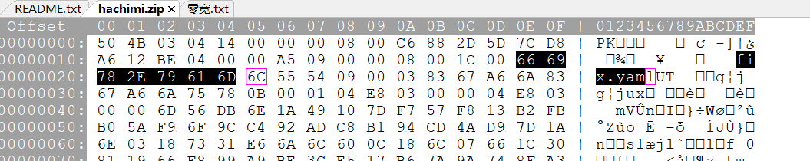
可以看到压缩包中其实还有一个`fix.yaml`的文件，这个文件没有被写入中央目录区，所以压缩包不能直接将其解压出来。  
对此笔者选择用WinRAR的修复功能自动修复压缩包（~~依旧偷懒~~），修复后即可正常解压。  
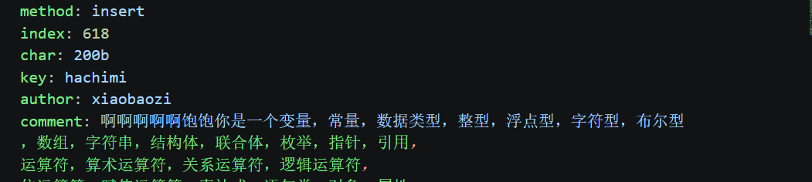
可以看到五个关键信息，首先根据作者xiaobaozi搜索互联网找到哈基米加密器，输入文本和密钥后可以解出原文。  
显然五个字符是不可能加密成几百个‘哈基米’的，所以可能是零宽字符隐写。复制到文本编辑器后可以印证我们的猜测。  
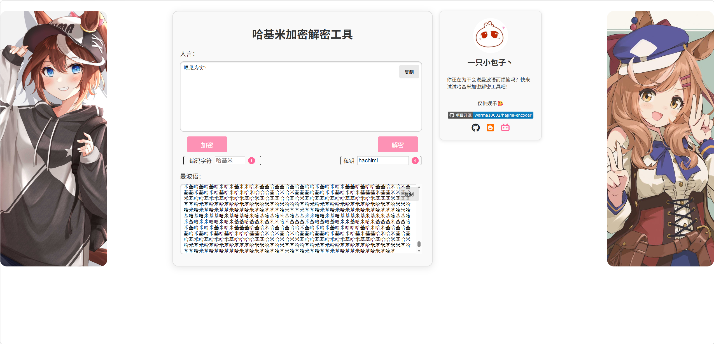
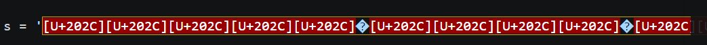
这里需要介绍一些常见的零宽度字符以及对应的Unicode码：
* 零宽度空格符 U+200B 用于较长单词的换行分隔
* 零宽度非断空格符 U+FEFF 用于组织特定位置的换行分隔
* 零宽度连字符 U+200D 用于阿拉伯文与印度语系中，让不会发生连字的字符产生连字效果
* 零宽度断字符 U+200C 阻止连字字符的连字效果
* 左至右符 U+200E 用于混合文字规定书写方向
* 右至左符 U+200F 同上

用零宽字符加密的过程本质是映射的过程，例如只用两个字符`U+200B``U+200C`加密，会从小到大对应二进制的0和1。
```
0 → U+200B
1 → U+200C
```
确定映射后，会将要隐藏的内容先转换为UTF8字节，然后写成二进制，最后替换成对应的零宽字符。
```
##方便起见，这里用转义符表示
A
↓ 转UTF-8
0x41
↓ 写成二进制
0100 0001
↓ 替换为零宽字符
\u200B\u200C\u200B\u200B\u200B\u200B\u200B\u200C
```
当用到更多字符时，就要根据情况确定映射，比如四种字符就可以单个字符表示两位二进制，然后再将二进制替换成对应的零宽字符。再比如三种字符，那就可以用三进制，因为3^5<256≤3^6，所以选择六位三进制表示，再或者两种字符对应01，第三种作为分隔符。总而言之，都需要提前规定好映射规则、分组方式、补位方式等。值得注意的是，字符不重复的情况下，加密是可以混用的。  
说了这么多，我们可以用这道题来印证一下，先来检查统计一下文本中出现了哪些零宽字符。需要提到的是，之前解出的`fix.yaml`文件已经提示要修复文本，所以在618位上加一个 U+200B。
```python
from collections import Counter
import unicodedata

s = '‌​‌​‌​‌​‍​‬​‍⁢‬⁢‌​‌​‌⁢‌​‍​‬​‌​‍​‌​‌⁢‌⁢‌​‍⁢‬​‬​​‌​‌​‌​‌​‍⁢‬​‍⁣‍​‌⁣‌​‌​‌​‍​‬​‍​‬⁢‌​‌⁣‌​‌​‍​‬​​‌​‌​‌​‌⁢‌⁢‍​‬⁣‌⁣‍​‌​‌​‌​‌​‍​‬⁢‍​⁣‌⁢‌​‌​‌​‍​​‬​​眼⁢见⁢为⁢实⁣‌​‌​‌​‌​‍​‍​‍​⁢‌​‌⁣‌⁢‌⁢‍​‬​‬​‌​‌​‌​‌​‌⁢‍⁣⁢‬​‍​‌​‌​‌​‌​‍​‍​⁢⁣‌⁢‌​‌​‌​‍​‬​‍​‌​‌⁢‌​‌⁣‌​‍⁢‬​​​‌​‌​‌​‌⁢‍​‍⁢⁢⁣‌​‌​‌​‌​‍​​‬⁢‍​‌⁣‌⁣‌⁢‌​‍​‬​​​‌​‌⁢‌⁢‌​‍⁢​‍​‍​‌​‌​‌​‌​‍​‍⁣​​‌​‌​‌​‌​‍​‬​‌​⁢‌​‌⁢‌⁢‌⁣‍​‬​​​‌​‌​‌⁢‌​‍⁣‬​​‍​‌​‌​‌​‌​‍​‬​‍⁢‍⁣‌⁢‌​‌​‌​‍​‍​​​‌⁢‌⁢‌​‌⁣‍​​‍​‌​‌​‌​‌​‌⁢‍⁢‬​⁢⁢‌​‌​‌​‌​‍​‍​⁢⁢‌​‌⁢‌​‌​‍​​‍​‌​‌​‌⁢‌⁢‌​‍⁣‬​‬​‌​‌​‌​‌​‌​‍​‬⁣‍⁢‍​？⁢‌​‌​‌​‌​‍​‍​​⁢‌⁣‌⁢‌⁢‌​‍​‬​‬​‌​‌​‌⁢‌​‌⁢‍⁢‬⁣‍​‍​‌​‌​‌​‌​‍​‬⁣​‌​‌⁢‌​‌​‌​‍​‬​​‌⁢‌⁢‌​‌⁢‌​‌​‬​‌​‍​‌​‌​‌⁢‌⁢‍⁢​​‍​​​​​⁢​⁢⁢⁣​​​​​​⁢​⁣⁢⁢​​​​​​​⁢⁣⁣​​​​​​​⁢⁢​⁣⁣​​​​​​⁢​⁢⁢⁣​​​​​​⁢⁢​⁣⁣​​​​​​⁢​⁣⁢⁣​​​​​​​⁢⁣⁣​​​​​​​⁢​⁢⁢⁣​​​​​​⁢⁢​⁣⁢​​​​​​​⁢⁣⁣​​​​​​​⁢​⁣​​​​​​​​⁢⁢​⁣​​​​​​​⁢​⁣​⁣​​​​​​​⁢⁣⁣⁢​​​​​​​⁢​⁣​​​​​​​⁢⁢⁢⁣⁣'

s = s[:618] + '\u200b' + s[618:]

for ch , count in sorted(Counter(s).items()):
    if unicodedata.category(ch) == 'Cf':
        print(f'U+{ord(ch):04X}',unicodedata.name(ch),count)
```
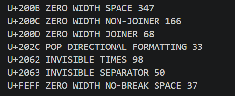  
最后的结果是七种字符都出现了，那还说啥了，直接用工具试一下吧。
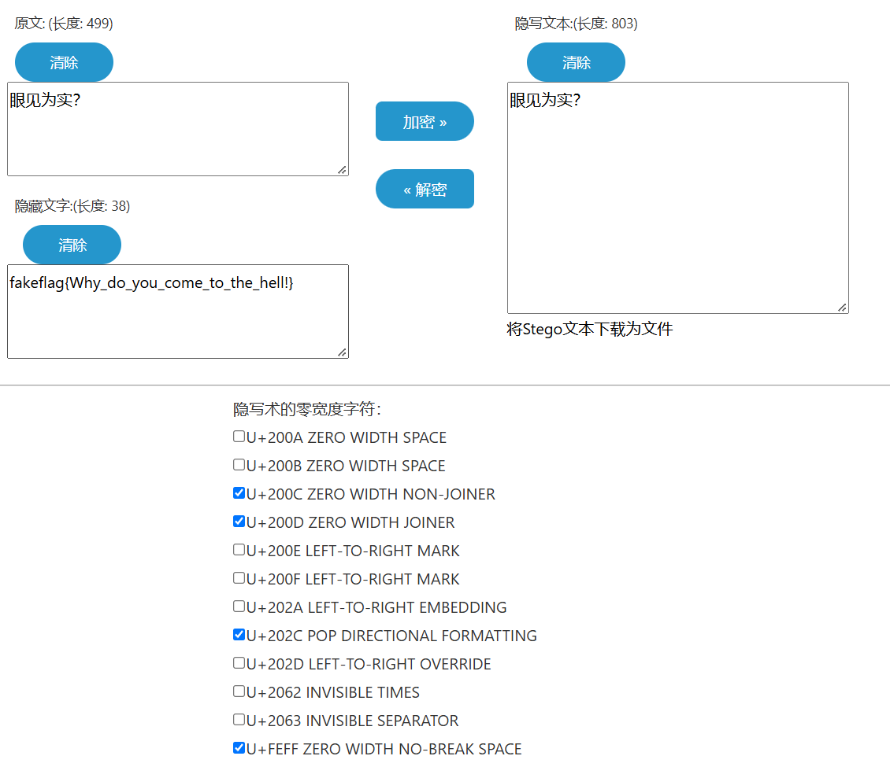  
默认的字符集解出了fakeflag，那么选择剩下的字符进行解密即可解出flag。
