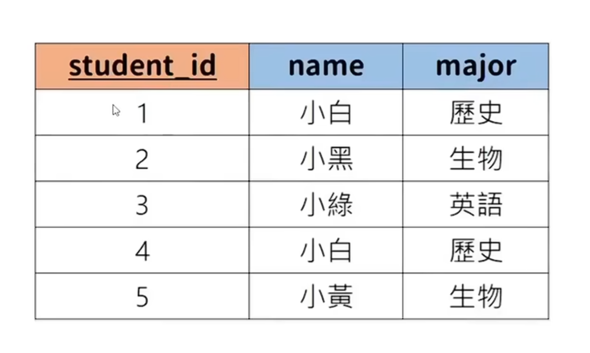

# 关于MySQL
作为目前最流行的数据库管理系统，是学习SQL注入的前置条件。本文将简单地梳理MySQL的基本知识，作为对我目前学习过的内容的复习，有不严谨处，欢迎指正。
## 什么是数据库
数据库(database)是按照数据结构来组织、存储和管理数据的仓库。与文件存储相比，数据库的存储量级远超文件，可以轻松处理上亿数据。所以，我们现在使用RDBMS(Relational Database Management System：关系数据库管理系统)来存储和管理大数据量。  

RDBMS的特点：
1. 数据以表格形式出现
2. 一行对应一组数据
3. 一列对应一种属性
4. 若干表格组成数据库

## RDBMS术语
1. 数据库(database)：数据库是表格的集合
2. 表格(table)：表格作为数据的矩阵
3. 行(row)：一行包含相关联的一组数据
4. 列(column)：一列包含相同类型的数据
5. 主键(primary key)：一张表格只能由一个主键，通常用主键查询数据
6. 外键(foreign)：用于关联表格

# MySQL基本的增删改查
MySQL的语法类似自然语言。从操作对象上可以分为对数据库，对表格，对具体数据。
## 对数据库
```sql
CREATE DATABASE `数据库名`; ---创建数据库
SHOW DATABASES; ---显示当前所有数据库
USE `数据库名`; ---选中某一数据库进行操作
```
## 对表格
我们以这张表格为例(下文的操作都以此为例)。其中student_id是主键。  
```sql
CREATE TABLE `student`(
    `STUDENT_ID` INT PRIMARY KEY,
    `NAME` VARCHAR(20),
    `MAJOR` VARCHAR(20)
)
```
运行后我们就创建了一张名为student的表格，包含了表格的三列:student_id,name,major。

我们可以用如下指令对表格进行操作
```sql
DESCRIBE `student`;   ---查看表格
DROP TABLE `student`;   ---删除表格
ALTER TABLE `student` ADD gpa DECIMAL(3,2);
ALTER TABLE `student` DROP COLUMN gpa; 
```

如下是常用的MySQL的数据类型
```sql
INT   ---整数
DECIMAL(3,2)   ---小数意为共三位数，小数点后有两位，如3.22
VARCHAR(10)   ---字符串，括号内数字决定最多几位字符
BLOB   ---(Binary Large Object)存储二进制数据，用于存储可能超出常规大小的数据，如图片，视频等
DATE   ---日期，'YYYY-MM-DD' 
TIMESTAMP   ---时间戳，'YYYY-MM-DD HH-MM-SS'
```

## 对数据
```sql
INSERT INTO `student` VALUES(1,'小白','历史');   ---是按照表格设定顺序填入数据
INSERT INTO `student` (`name`,`major`,`student_id`) VALUES('小黑','生物',2);   ---按照第一个括号内顺序填入数据
UPDATE `student`
SET `major` = '生物化学'
WHERE `major` = '生物';   ---更新数据，根据条件设定即可，WHERE后的多个条件可以用AND或者OR连接，SET后的多项改动用逗号连接，逗号起并列作用。
DELETE FROM `student`
WHERE `student_id` = 2;   ---删除数据
SELECT `name`
FROM `student`;   ---查询数据
```
以下是常用比较符号
```sql
>   ---大于
<   ---小于
<>   ---不等于
=   ---等于
>=   ---大等于
<=   ---小等于
```
关于查询，有以下几种常见的限制条件
```sql
ORDER BY `name` DESC(descend)/ASC(ascend);   ---按某一属性排序
LIMIT 3;   ---限制数量，只回传前三笔
```
在SQL注入中经常见到select * from `table` order by 3.  
这里的*是通配符，表示查询所有数据。order by 3则是指按照表格固定顺序第三个对数据进行排列。
