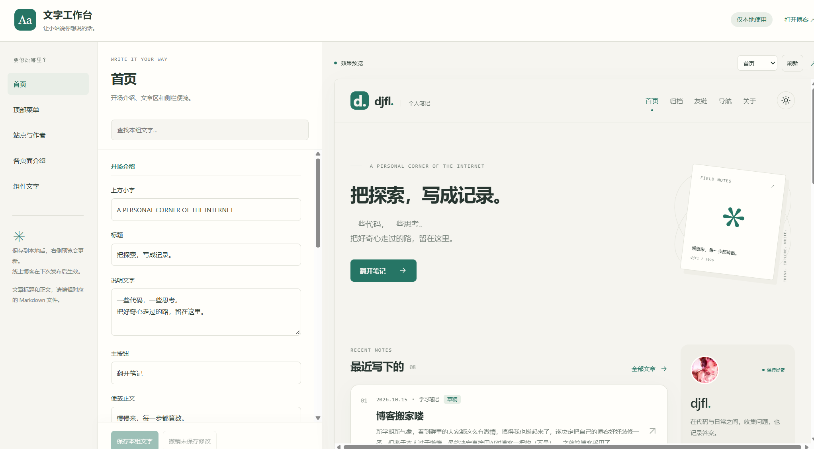
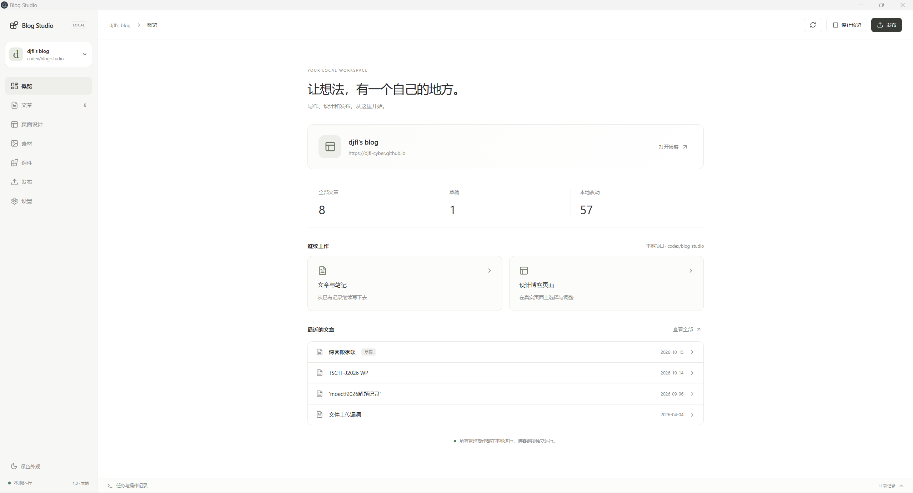

# 碎碎念
新学期新气象，看到群里的大家都这么有激情，搞得我也燃起来了，遂决定把自己的博客好好装修一番，但鉴于本人过于懒惰，最终决定直接用AI对博客一把梭（~~不是~~）。  
# 设计思路
之前的博客采用了`hexo`+`Butterfly`的组合，虽然说butterfly支持很多自定义项，但对我而言最大的问题是自由度不够和调整太麻烦，不能做到随心所欲地布局和修改，所以这次决定换成`Astro`，然后自己设计一个图形化管理界面，将所有bash中运行的指令和源文件中的修改全部集成为一个后端系统（我说GUI是好文明）。虽然这个想法和极客二字相去甚远，但是深得我心，或许我从一开始就不是一个正经的极客？  

111  

开工之前先总体上规划一下：  
1. 实现一个可以在本地运行静态博客管理系统，最终呈现为图形化界面。主要有三方面要求：第一，能够随意调整博客界面布局、文本、图片、背景等，预设操作逻辑类似于PPT，但是最终界面要比PPT简洁。第二，要将bash中运行的指令全部集成到系统上，免去手写指令的麻烦（但是仍然保留这一项功能）。第三，预留组件接口，要求能够在系统中导入各种符合规范的组件来为博客提供特殊功能，例如桌宠、音乐播放器、抽卡（？）等一系列功能。
2. 优化之前写博客遇到的痛点，例如粘贴的图片还需要自己手动调整引用路径、文章过长后目录页无法对齐、图片过多后如何储存等。
3. 最终在本地工作台调整博客，然后只将博客页面上传到git仓库，避免意外风险问题。
# 遇到的困难
## vscode中markdown快捷键无法使用
在从旧博客迁移到新框架的第一步果然不出意外的出意外了，vscode的js插件和markdown all in one插件发生了冲突，会导致退格键和回车键卡死，且侧边预览页面无法渲染。解决方法是删除js插件和手动修改快捷键设置。先说前者，本来是停用js插件即可，但是本人停用后没有生效，只能删除。后者则需要打开`Preferences: Open Keyboard Shortcuts (JSON)`，如果内容是空数组，将下面的内容粘贴进去即可。
```json
[
  {
    "key": "enter",
    "command": "-markdown.extension.onEnterKey"
  },
  {
    "key": "backspace",
    "command": "-markdown.extension.onBackspaceKey"
  }
]
```

