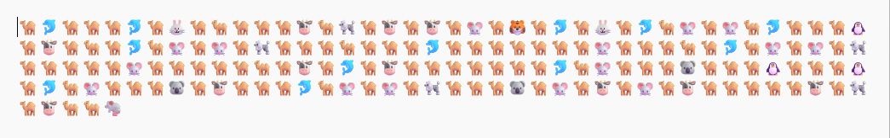
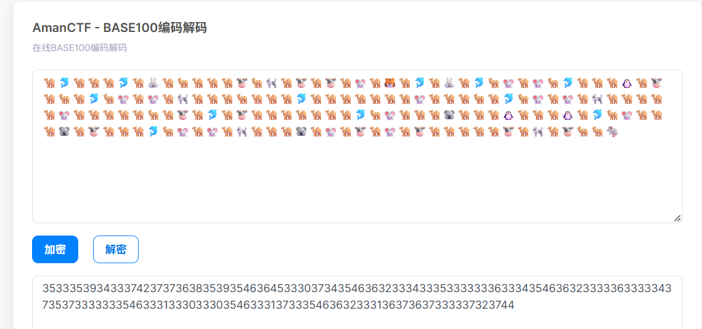
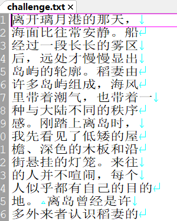
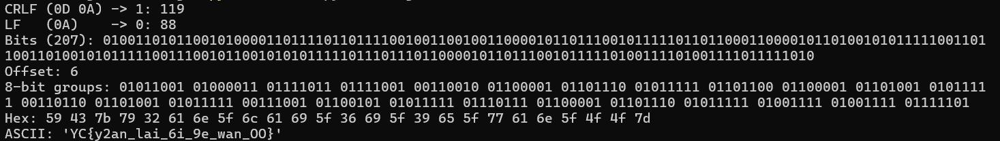
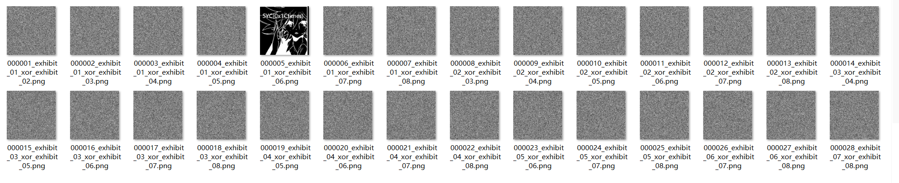
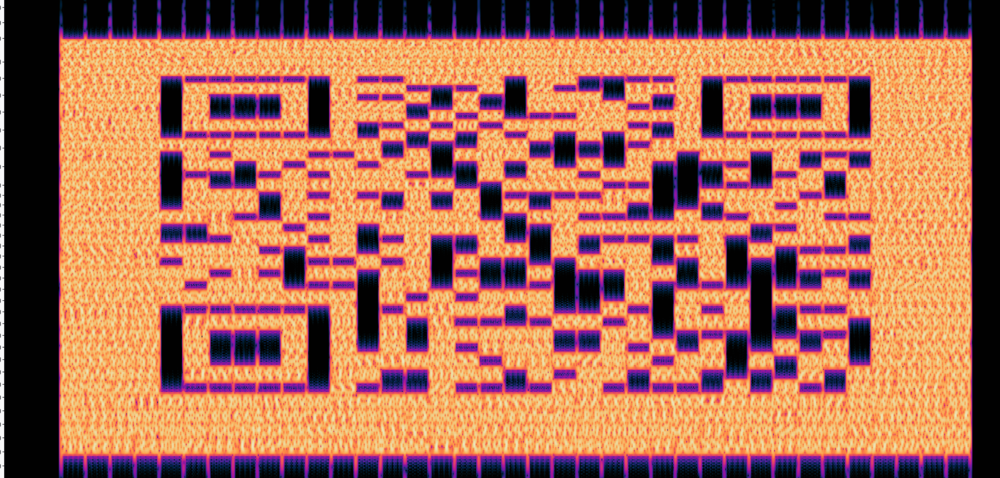
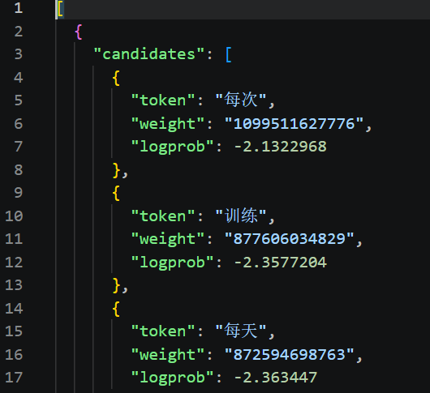
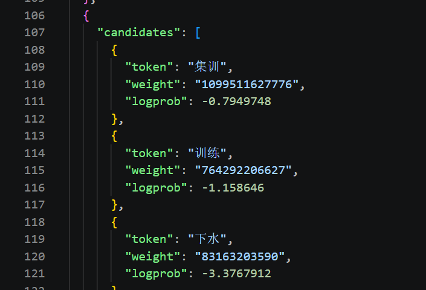

## 前言
去年今朝花依旧，回首不堪再登楼。时隔一年，又一次回来打极客大挑战了，依旧和KA组队，依旧misc方向，不过今年不同的是，我从小菜鸡进化成了中菜鸡（~~队友已经成为了大肘子~~），并且开启了传说中的蓝色形态。  
本文采取边打边写的模式，应该会主攻misc方向，希望今年能取得一个不错的成绩吧。  
（二编已经是将近两周之后了，鸽子属性大爆发）  
（三编已经弃坑了，完全游戏上瘾了，一点题都不想做）
## misc
### 好多的骆驼
  
如题目所言，确实有很多骆驼。  
从数量关系上可以看出，骆驼占据了绝大多数字符，剩下的动物emoji数量骤然减少，大概数一下超过10种emoji。既然是emoji，可以考虑BASE100编码，这种编码用256种emoji对应256个字节，完全由emoji组成，可以预料到，解出之后应该依然是某种字符占大多数。  
  
可以发现，解码后的结果中3占据大多数，如果有惊人的注意力，那可以联想到，0-9在ASCII表十六进制中对应的位置正好是0x30到0x39，解码一次的结果是`5359437B7768595F6E30745F6234353336345F623363347573335F3130305F31735F6231676733727D`，非常明显的16进制，再解码得到flag`SYC{whY_n0t_b45364_b3c4us3_100_1s_b1gg3r}`。
### ！？原原？！
  
编辑器打开可以看到用了两种换行符，此外没有别的信息。二元可以考虑映射01。写一个脚本转成01再转成ASCII，这个过程需要跳过开头六位数，得到缺少了S的flag。合理怀疑是要补上前两位组成S，也就是在最前面补上01，刚好组成01010011，即0x53，对应S。  
脚本如下：
```python
"""将 CRLF 转成 0、LF 转成 1，再按每 8 位解码为 ASCII。"""

import argparse
from pathlib import Path
import re


def extract_bits(data: bytes) -> tuple[str, int, int, int]:
    # 必须先匹配 CRLF，避免将其中的 LF 再算一次。
    endings = re.findall(rb"\r\n|\r|\n", data)
    crlf_count = endings.count(b"\r\n")
    lf_count = endings.count(b"\n")
    cr_count = endings.count(b"\r")
    bits = "".join("1" if end == b"\r\n" else "0"
                   for end in endings if end != b"\r")
    return bits, crlf_count, lf_count, cr_count


def main() -> None:
    parser = argparse.ArgumentParser(description=__doc__)
    parser.add_argument("file", type=Path, help="待分析文件的路径")
    parser.add_argument("--offset", type=int, choices=range(8), default=0,
                        help="跳过开头的位数（0～7），默认 0")
    args = parser.parse_args()

    try:
        # read_bytes() 保留原始换行符；文本模式读取可能统一换行符。
        data = args.file.read_bytes()
    except OSError as exc:
        parser.exit(1, f"Cannot read file: {exc}\n")

    bits, crlf_count, lf_count, cr_count = extract_bits(data)
    print(f"CRLF (0D 0A) -> 1: {crlf_count}")
    print(f"LF   (0A)    -> 0: {lf_count}")
    if cr_count:
        print(f"Standalone CR (0D), ignored: {cr_count}")
    print(f"Bits ({len(bits)}): {bits}")

    selected = bits[args.offset:]
    complete_length = len(selected) // 8 * 8
    groups = [selected[i:i + 8] for i in range(0, complete_length, 8)]
    decoded = bytes(int(group, 2) for group in groups)
    print(f"Offset: {args.offset}")
    print("8-bit groups:", " ".join(groups))
    print("Hex:", decoded.hex(" "))
    # 非 ASCII 字节和控制字符以转义形式显示，便于检查。
    print("ASCII:", repr(decoded.decode("ascii", errors="backslashreplace")))
    print("Remaining bits (not decoded):", selected[complete_length:] or "(none)")


if __name__ == "__main__":
    main()

```  
  
flag是`SYC{y2an_lai_6i_9e_wan_OO}`。  
（吐槽一下，这个flag实在是太过抽象，如果没见过‘原来你也玩原神’根本读不出来，完全不具备可读性。）  
## 你看见BIGX了吗
打开后是八张600*600黑白像素交错的图片，用黑白对应01，将所有图片两两异或，最后会得到写有flag的原始图片。  
脚本如下：
```python
"""将当前目录中的 PNG 图片两两异或，输出到一个文件夹中。

安装依赖：python -m pip install Pillow
用法：python xor_images.py
指定输出文件夹：python xor_images.py -o results

输入统一转为 RGB；透明度不参与运算，输出为不透明图片。
这里异或的是解码后的像素，而不是图片文件的压缩数据。
只扫描当前工作目录中的 .png 文件（扩展名不区分大小写），不扫描子文件夹。
如果输入为动画 PNG，只使用第一帧。
"""

import argparse
from itertools import combinations
from pathlib import Path

try:
    from PIL import Image
except ImportError:
    raise SystemExit("缺少 Pillow，请先运行：python -m pip install Pillow")


def xor_images(first_path: Path, second_path: Path, output_path: Path) -> None:
    """逐通道计算 output = image1 XOR image2，并保存为 PNG。"""
    first_path = Path(first_path)
    second_path = Path(second_path)
    output_path = Path(output_path)

    if output_path.suffix.lower() != ".png":
        raise ValueError("输出文件请使用 .png 后缀，以保证异或结果无损保存。")
    if output_path.resolve() in (first_path.resolve(), second_path.resolve()):
        raise ValueError("输出路径不能与输入路径相同。")

    with Image.open(first_path) as first, Image.open(second_path) as second:
        if first.size != second.size:
            raise ValueError(
                f"两张图片尺寸不同：{first.size} 和 {second.size}。"
            )

        first_rgb = first.convert("RGB")
        second_rgb = second.convert("RGB")
        pixels = bytes(
            a ^ b for a, b in zip(first_rgb.tobytes(), second_rgb.tobytes())
        )
        result = Image.frombytes("RGB", first.size, pixels)
        result.save(output_path, format="PNG")


def batch_xor_images(directory: Path, output_dir: Path) -> tuple[int, int]:
    """处理每个不重复的图片组合，返回（成功数量，跳过数量）。"""
    directory = Path(directory).resolve()
    output_dir = Path(output_dir).resolve()
    if output_dir == directory:
        raise ValueError("请使用独立的输出文件夹，不要直接输出到输入目录。")

    images = sorted(
        (
            path for path in directory.iterdir()
            if path.is_file() and path.suffix.lower() == ".png"
        ),
        key=lambda path: path.name,
    )
    if len(images) < 2:
        raise ValueError("当前目录中至少需要两张 PNG 图片。")

    output_dir.mkdir(parents=True, exist_ok=True)
    total = len(images) * (len(images) - 1) // 2
    print(f"找到 {len(images)} 张图片，共 {total} 个组合。")
    saved = skipped = 0
    for pair_number, (first, second) in enumerate(combinations(images, 2), start=1):
        # 序号保证结果名称唯一；截短名称避免路径过长。
        filename = (
            f"{pair_number:06d}_{first.stem[:40]}_xor_{second.stem[:40]}.png"
        )
        output_path = output_dir / filename
        try:
            xor_images(first, second, output_path)
        except (OSError, ValueError) as exc:
            skipped += 1
            print(f"[{pair_number}/{total}] 跳过 {first.name} + {second.name}：{exc}")
            continue
        saved += 1
        print(f"[{pair_number}/{total}] 已保存：{filename}")

    print(f"完成：成功 {saved} 个，跳过 {skipped} 个。输出文件夹：{output_dir}")
    return saved, skipped


def main() -> None:
    parser = argparse.ArgumentParser(
        description="将当前目录中的 PNG 图片两两异或，保存为 PNG（不处理透明度）。"
    )
    parser.add_argument(
        "-o", "--output", type=Path, default=Path("xor_results"),
        help="输出文件夹，默认为当前目录下的 xor_results",
    )
    args = parser.parse_args()

    try:
        batch_xor_images(Path.cwd(), args.output)
    except (OSError, ValueError) as exc:
        parser.exit(1, f"错误：{exc}\n")


if __name__ == "__main__":
    main()

```

flag是`0x1Ctimes`。  
## ez_office
打开文档能看到第一部分flag，标准的base64且以`==`结尾，说明每一部分都是单独编码，不是整体编码之后拆分（似乎说这句话没什么意义）。  
把文档转成压缩包解压查看，会发现一张隐藏的图片，名字带有blind，作为1024*1024的图片来说，有足足4mb，显然藏东西了……吗？  
这里是我才疏学浅了，分辨率和图片大小的关系并不是这么简单的。对于一张32位BMP未压缩图片，它的大小等于`1024*1024*4+54`，4mb是合理的。  
这道题的考点其实是`傅里叶频域水印`

## 真相只有喵知道！
一道音频隐写题目，题目描述已经提示黑白、自己扫，最终效果应该是在音频中提取出一张二维码图片进行扫描。  
用audacity打开音频，显示频谱，能够看到除了猫叫的频谱之外还有一层奇怪的频谱，稍作调整可以看出这是一个藏在频谱图里的二维码，需要据此修复二维码。  
  
将橙黄色看作白色，去掉缝隙和噪声，预留白色边框。  
脚本后面再补，复盘的时候做不出来了。  
最终flag为`SYC{mia0Miaom1ao_mi4O_mIaoMiao_mi4om1a0}`。  

## メシアたん
压缩包里是一个txt文本和json文件，该json文件是大语言模型生成文本时的候选token概率记录，对于每一步的候选token，有三个属性，候选文字`token`、权重`weight`、对数概率`logprob`，和txt文本比较一下，这里的候选token是从`每次训练结束后`这句话开始，那么大致可以确定的第一步是先对照txt把json文件中对应的候选token提取出来。  
  
  
在提取出候选token之后该如何找出隐藏的flag呢？这里用到了一种基于算术编码控制选词的隐写方法。原理可以参考论文：https://aclanthology.org/2020.emnlp-main.22.pdf。  
现在解释一下大致原理：大语言模型生成文本时会根据已有内容，预测下一个token，正常生成过程会按照概率随机采样，隐写生成则会根据密文决定选择哪个token，同时保留语言模型偏好。假设我们将密文转为一个二进制小数，比如`0.1011`，十进制数就是0.6875，假设我们有三个候选token分别是A、B、C，他们的对应的概率分别是50%、30%、20%。那么对应区间就是[0, 0.5)、[0.5, 0.8)、[0.8, 1)，显然0.6875落在第二个区间，所以从候选中输出B。然后继续把B对应的[0.5, 0.8)区间按照下一步的候选概率重新切分，按照同样规则输出候选项。按照这种方法，密文对应的二进制小数是不变的，只要根据候选token对应的概率一步步缩小区间，最终就可以通过大语言模型输出一段看起来没有任何问题的文本且在其中隐藏大量信息。  
这种方法每多输出一个token，就会进一步限定密文小数的位置。同样的，只要能知道候选概率，读出实际选择的token，就可以逆推出秘密小数的范围，虽然不能得到精确值，但是只要次数够多，理论上是可以推出大部分密文（脑测过多轮次会导致后缀无意义信息）。  
回到这道题，我们已知大语言模型生成的结果，需要根据权重和对数概率算出概率区间，然后根据概率区间反推密文小数。AI测算后